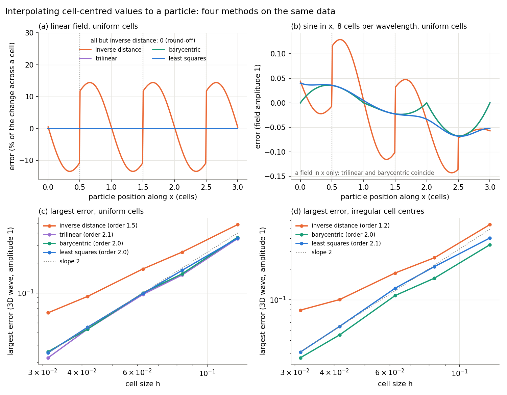
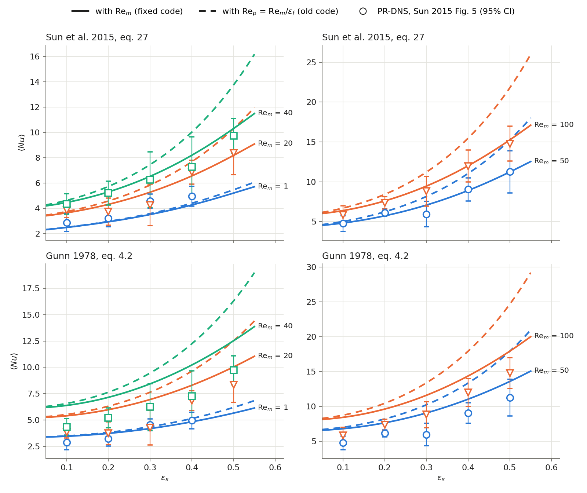
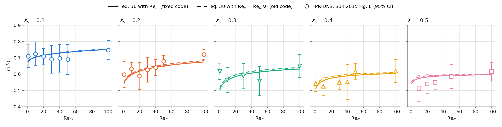
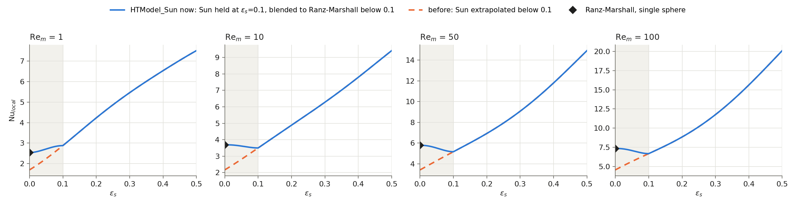
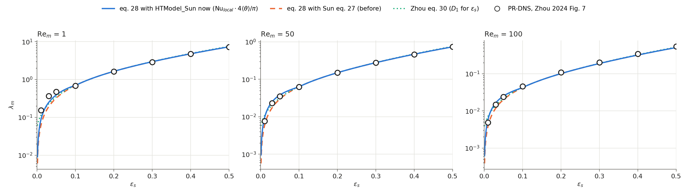
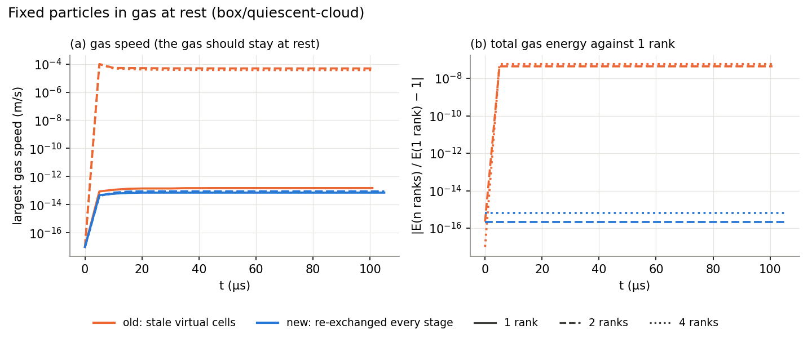
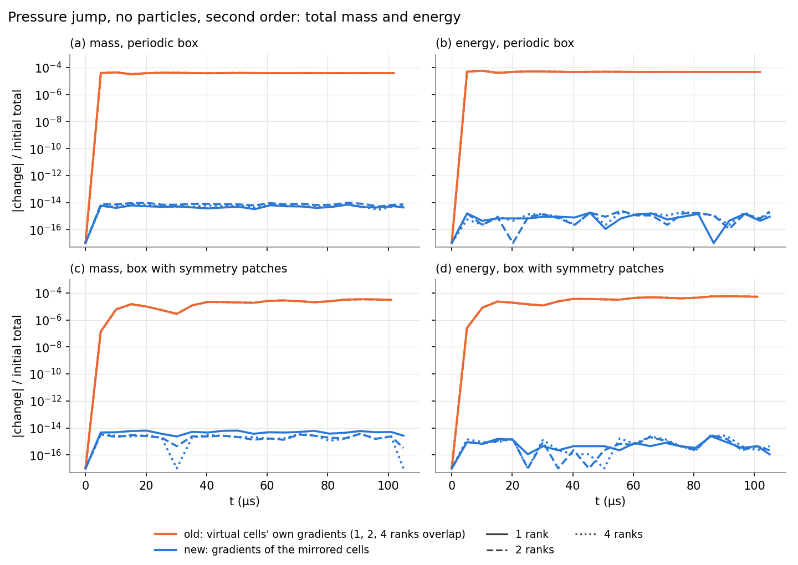

# Recent Improvements and Fixes

This page lists recent improvements and fixes to the particle–gas coupling: interpolating
the gas to the particles, projecting the particles back onto the mesh, the drag and heat
closures, particle collisions with each other and with walls, memory, and conservation
across MPI ranks and periodic boundaries. For each: what was wrong, how it was fixed, and
how the fix was checked.

All changes are covered by the regression suite in [Regression Tests](../tests/README.md):
38 cases, compared against stored goldens and checked against physics on 1, 2 and 4 ranks,
and one unit test.

## Contents

- [Summary](#summary)
- [Regression Tests](#regression-tests)
- [Interpolation: Weighted Linear Least Squares](#interpolation-weighted-linear-least-squares)
  - [Choosing the Interpolation Method](#choosing-the-interpolation-method)
  - [Interpolation in Shock-Driven Flows](#interpolation-in-shock-driven-flows)
- [Where a Particle Stage Spends Its Time, and a Faster Stencil Search](#where-a-particle-stage-spends-its-time-and-a-faster-stencil-search)
  - [Measured Breakdown](#measured-breakdown)
  - [A Faster Stencil Search](#a-faster-stencil-search)
- [Projection: Kernel Width per Direction, and Cloud-Edge Cells](#projection-kernel-width-per-direction-and-cloud-edge-cells)
- [Low-Slip Closures](#low-slip-closures)
- [Quasi-Steady Drag](#quasi-steady-drag)
- [Heat Transfer: Reynolds Number in the Gunn and Sun Correlations](#heat-transfer-reynolds-number-in-the-gunn-and-sun-correlations)
  - [Nusselt Number against PR-DNS](#nusselt-number-against-pr-dns)
  - [Mean Scaled Fluid Temperature](#mean-scaled-fluid-temperature)
  - [Heat Rate in a Run](#heat-rate-in-a-run)
- [Heat Transfer: Sun's Correlation in Dilute Regions](#heat-transfer-suns-correlation-in-dilute-regions)
  - [Mean Temperature Decay against PR-DNS](#mean-temperature-decay-against-pr-dns)
  - [Heat Rate in a Dilute Run](#heat-rate-in-a-dilute-run)
- [Random Numbers for the Stochastic Models](#random-numbers-for-the-stochastic-models)
- [Particle Collisions](#particle-collisions)
  - [Contact Stiffness from the Pair's Effective Mass](#contact-stiffness-from-the-pairs-effective-mass)
  - [Ghost Particles and the Neighbour Search](#ghost-particles-and-the-neighbour-search)
- [Particle–Wall Collisions](#particlewall-collisions)
  - [Turning Walls On](#turning-walls-on)
  - [What Changed](#what-changed)
  - [Results](#results)
- [Memory: ppiclF Arrays Sized at Run Time](#memory-ppiclf-arrays-sized-at-run-time)
  - [The Problem](#the-problem)
  - [What Changed](#what-changed-1)
  - [How the Arrays Grow](#how-the-arrays-grow)
  - [Two Bugs Found on the Way](#two-bugs-found-on-the-way)
  - [How It Was Checked](#how-it-was-checked)
  - [What Changes for Users and Developers](#what-changes-for-users-and-developers)
  - [Field Sizes Set at Run Time](#field-sizes-set-at-run-time)
- [Particle Properties (rprop)](#particle-properties-rprop)
  - [Ghosts Carry Only What the Neighbour Search Reads](#ghosts-carry-only-what-the-neighbour-search-reads)
  - [Particle Output: A List of Named Fields](#particle-output-a-list-of-named-fields)
  - [Unused Slots Removed, the Rest Grouped by Job](#unused-slots-removed-the-rest-grouped-by-job)
- [Particle Bins: Number of Bins per Direction](#particle-bins-number-of-bins-per-direction)
  - [What Went Wrong](#what-went-wrong)
  - [The New Count](#the-new-count)
  - [How the New Count Was Checked](#how-the-new-count-was-checked)
- [MPI and Periodic Boundaries](#mpi-and-periodic-boundaries)
- [Still Open](#still-open)
- [Reproducing the Figures](#reproducing-the-figures)

## Summary

| Area | Problem | Fix | Commit |
|---|---|---|---|
| Interpolation | Inverse distance (1/d³) had errors of up to ±18% of the change in density across one cell, even in a linear field, and was discontinuous at cell faces. A particle sheet hit by a planar shock rippled with the cell size (57 µm standard deviation after 250 µs) | Weighted linear least squares, exact for linear fields; the sheet stays flat (0.07 µm) | [89f9661](https://github.com/thierrydaoud/Rocflu/commit/89f9661), [6d00ca4](https://github.com/thierrydaoud/Rocflu/commit/6d00ca4) |
| Projection | The kernel used one length for every direction, so the spread on stretched cells was wrong | Each direction is scaled by its own cell length | [414ce7f](https://github.com/thierrydaoud/Rocflu/commit/414ce7f) |
| Projection | Cells just outside the bin domain were dropped, so cloud-edge particles reached 8 cells instead of 27; φ was ~8% too high at the edge | Map those cells to particle bins | [affad85](https://github.com/thierrydaoud/Rocflu/commit/affad85) |
| Closures | Forces and heat transfer were skipped below 1 mm/s slip, and the old value was kept | Evaluate at any slip; skip only the quasi-steady drag at zero slip | [f0ae123](https://github.com/thierrydaoud/Rocflu/commit/f0ae123) |
| Quasi-steady drag | Gidaspow's C_D was capped below Re = 0.1 (100% error); Osnes had a spurious Knudsen reduction (25% error) | Correlations match the published ones; QSFORCE renumbered | [94607fd](https://github.com/thierrydaoud/Rocflu/commit/94607fd) |
| Heat transfer | Gunn's and Sun's Nusselt correlations were evaluated with the particle Reynolds number Re_p instead of the mean slip Reynolds number Re_m = ε_f Re_p they were fitted with: Nu up to 35% too high (Sun) and 62% (Gunn) at ε_s = 0.5 | Both use Re_m; Sun's Nu is within 7.9% of its PR-DNS data on average (20.9% before) | [3c677d9](https://github.com/thierrydaoud/Rocflu/commit/3c677d9) |
| Heat transfer | Sun's correlation, fitted for ε_s = 0.1–0.5, was extrapolated below 0.1: as ε_s → 0 the per-particle Nu went to π/2 instead of 2, 33–41% below a single sphere at Re_m = 1–100 | Below ε_s = 0.1, Sun's value at 0.1 is blended into Ranz–Marshall | [955ba8e](https://github.com/thierrydaoud/Rocflu/commit/955ba8e) |
| MPI | Gas state in virtual cells was stale at rank borders with particles, setting the gas around a quiescent cloud moving (1e-4 m/s) on 2+ ranks; total gas energy differed from 1 rank by 5e-8 | Convert and re-exchange after φ is known; exchange φ every stage | [e3ed370](https://github.com/thierrydaoud/Rocflu/commit/e3ed370) |
| Conservation | Fluxes on periodic and symmetry patches were not conservative | Exchange and transform gradients in virtual cells | [11dc640](https://github.com/thierrydaoud/Rocflu/commit/11dc640) |
| Robustness | A single particle gave a filter width of 0 | Filter width from cell–box overlap | [48f64b7](https://github.com/thierrydaoud/Rocflu/commit/48f64b7) |
| Build | Required `SPEC=1` | Builds without it; stops if species are requested | [aa3c0b6](https://github.com/thierrydaoud/Rocflu/commit/aa3c0b6) |
| Random numbers | QS fluctuations drew from one generator per rank, every rank seeded with 1: the same noise on every rank, and results that changed with the number of ranks | Each particle has its own stream (splitmix32), seeded with its line in `points.dat` and carried with the particle; 1 and 2 ranks now give identical results | (section "Random numbers for the stochastic models") |
| Collisions | The contact stiffness used particle i's own mass, so an unequal pair felt unequal forces: an 8:1 pair at 20 m/s ended with its total momentum reversed | Stiffness from the pair's effective mass (soft-sphere model) | [3afd23a](https://github.com/thierrydaoud/Rocflu/commit/3afd23a), [78eb711](https://github.com/thierrydaoud/Rocflu/commit/78eb711) |
| Particle walls | Walls existed only through `filein.vtk`; a particle over the edge between two wall triangles was pushed by both (e = 0.60 instead of 0.70); a fast particle went through the wall and the run crashed | Walls from the fluid wall patches (`PARTWALL 1`), contacts computed like pair contacts, a fluid side that pushes back; `filein.vtk` removed | [2ff0cd8](https://github.com/thierrydaoud/Rocflu/commit/2ff0cd8) |
| Ghost particles | Overflowing the ghost arrays wrote past their end | Guards stop the run; ghost arrays 30% smaller | [f7a3980](https://github.com/thierrydaoud/Rocflu/commit/f7a3980), [0bb2e4b](https://github.com/thierrydaoud/Rocflu/commit/0bb2e4b) |
| Neighbour search | Dense subbin tables: ~28 GB requested for 50,000 particles in one 2 cm bin | Compact lists: ~1.2 MB for the same bin (about 24,000 times less), byte-identical results | [82d4ca4](https://github.com/thierrydaoud/Rocflu/commit/82d4ca4) |
| Clean-up | ppiclF's own unit tests no longer matched the code; the burn-rate model and the `PICLDEBUG` output were unused | Removed; the regression suite replaces the unit tests. Input files that still ask for `REACTIVE` or a negative `STATIONARY` stop with a message | [3c41db2](https://github.com/thierrydaoud/Rocflu/commit/3c41db2) |
| Memory | ppiclF reserved fixed arrays for 80,000 particles, 640,000 ghosts and 120,000 cells per rank, plus 50 steps of viscous-unsteady history even when it was off: 1.34 GB for a run with one particle. A run with more particles on a rank stopped and needed a recompile | Arrays sized from the run and grown when needed; the history is allocated only with `VISCOUSUNSTEADY` (`VUSTEPS` steps). 265 MB for the same run; no particle, ghost, cell or wall limits | [c1ac692](https://github.com/thierrydaoud/Rocflu/commit/c1ac692), [0d4d86c](https://github.com/thierrydaoud/Rocflu/commit/0d4d86c), [e227f99](https://github.com/thierrydaoud/Rocflu/commit/e227f99) |
| Particle output | Every file held all 72 particle fields, named `y01`…, `rpro01`…, `tag01`… (300 bytes per particle) | A list of named fields: velocity, volume fraction, diameter and ID by default (44 bytes per particle); more groups with `PARTICLE_WRT`, `GAS_WRT`, `GRADGAS_WRT`, `MODEL_WRT`. Restarts read the particle dump in `restart_data/` ([Input File](InputFile.md#output-and-restarts)) | (this section) |
| Interpolation speed | 60% of a particle stage went to finding the cells around each particle | Marker per cell, an early exit and contiguous reads: that search is 45% faster, the whole run 14–20% faster, results bit-identical | (section "Where a particle stage spends its time") |
| Ghost particles | A ghost carried all 59 particle properties; the neighbour search reads 6 | A ghost carries those 6 (16 doubles instead of 69), byte-identical results | [a7f5748](https://github.com/thierrydaoud/Rocflu/commit/a7f5748) |
| Field sizes | The number of fields per particle and per cell (state, properties, interpolated, projected) was fixed at compile time; Rocflu's number of interpolated fields had to match it by hand; every run interpolated 29 gas fields and projected 31 | Set at start-up by `ppiclf_user_Layout` from the physics that is on: 7 interpolated fields for drag only; ppiclF stops if a needed field is not given; byte-identical flow files | [074d58d](https://github.com/thierrydaoud/Rocflu/commit/074d58d), (section "Field sizes set at run time") |
| Input | Mistakes in the input were found at run time, after the job started, or never: a typo or misplaced key was silently ignored, `QSFLUCT` ran without a drag, unused keys (`FILTERWIDTH`, angular periodicity, `REACTIVE`) had to be given; the particle material came from `# MATERIAL` by name; the build without particles did not compile | Case validator (`./rocflu.sh validate`, run first by `rocflu.sh run` and the suite) checks keys, values, model combinations, `points.dat` and the particles' position before anything is built ([Input File](InputFile.md)); `VELOCITYMODEL` replaces `STATIONARY`; `DENSITY`, `SPECIFICHEAT` in `# PICL`; `points.dat` is `x y z vx vy vz dp`; `--no-picl` builds and runs | [2b0c7a7](https://github.com/thierrydaoud/Rocflu/commit/2b0c7a7), [59da501](https://github.com/thierrydaoud/Rocflu/commit/59da501), [488e5df](https://github.com/thierrydaoud/Rocflu/commit/488e5df), [b12cb48](https://github.com/thierrydaoud/Rocflu/commit/b12cb48), [88542ac](https://github.com/thierrydaoud/Rocflu/commit/88542ac), [9d8be80](https://github.com/thierrydaoud/Rocflu/commit/9d8be80), [4add494](https://github.com/thierrydaoud/Rocflu/commit/4add494) |
| Particle bins | A particle bed stretched along one direction stopped the run with "Error in Createbins": the bin count split the bins with a wrong formula and went on with too many bins when its search failed (12% of bin boxes in a scan) | Bins added one at a time to the direction with the longest bins; valid for every box. Unit test in the suite | [0688f68](https://github.com/thierrydaoud/Rocflu/commit/0688f68), [0887252](https://github.com/thierrydaoud/Rocflu/commit/0887252) |

## Regression Tests

Every fix on this branch is guarded by the suite in [Regression Tests](../tests/README.md). It
runs small cases of the full code (grid, pre-processing, Rocflu and ppiclF) and judges
each one in two ways: against a stored golden, which catches any change, and against
physics checks (conservation, exact interpolation of a linear field, restitution,
decomposition independence), which say whether the result is right. The cases are:

- **Shock tube** (12 cases): a Mach 1.27 shock over 1 or 4 particles, one- and two-way,
  with each force model switched on in turn (added mass, pressure gradient, viscous
  unsteady, heat transfer, quasi-steady fluctuations, Parmar and Gidaspow drag).
- **Box** (21 cases): an 8 mm cube, periodic or closed. Momentum and energy exchange,
  a quiescent cloud, heat exchange at rest, interpolation of a linear field, the
  projection on elongated cells, collisions through ghosts and periodic faces, binary
  collisions, and particle–wall collisions.
- **Gas only** (5 cases): a pressure jump in a closed, a periodic and a symmetry box,
  testing the flow solver's own conservation.
- **Unit** (1 test): ppiclF's bin count, without MPI (see
  [Particle Bins](#particle-bins-number-of-bins-per-direction)).

Most cases run on 1, 2 and 4 ranks and must give the same particles on each. To run
them, from `tests/`:

```bash
module purge; module load gcc/14.2.0 openmpi/5.0.7
./run_tests.py run                     # all 38 cases and the unit test
./run_tests.py run -o box/walls        # a subset
```

[Regression Tests](../tests/README.md) lists every case and check, and explains how to
run on a login node or through Slurm, read a failure and regenerate goldens after an
intended change.

## Interpolation: Weighted Linear Least Squares

A tracer moves across cells in a gas whose density varies linearly in x. Each cell
centre holds the exact value, so a correct interpolation returns the straight line.


The old 1/d³ weighting pulled the value towards the nearest cell centre. The result was a
staircase with errors of up to ±18% of the density change across one cell, and it jumped
at every face. Weighted linear least squares (radius 1.8h) reproduces linear fields to
round-off, and its value is continuous as the particle crosses a face. Each cell also now
enters each bin's stencil only once; before, a two-bin periodic case counted some cells
twice.

### Choosing the Interpolation Method

Rocflu stores each field as one value per cell, at the cell centroid. ppiclF has to turn
those values into the value at a particle. Four common ways to do it:

- **Inverse distance** (Shepard, 1968; the old ppiclF method): a weighted mean of the
  nearby cell values, weight 1/d³. ppiclF used the cells within 1.5 cell lengths.
- **Trilinear**: the 8 cell centres around the particle form a box; the value is the
  product of linear interpolations in x, y and z.
- **Barycentric**: the cell centres are split into tetrahedra; the value is the linear
  function through the 4 corners of the tetrahedron that contains the particle. Finding
  that tetrahedron is a point-location search on the dual mesh, as for particles on
  unstructured grids (Haselbacher, Najjar and Ferry, 2007).
- **Weighted linear least squares** (moving least squares, Lancaster and Salkauskas, 1981;
  the current method, `ppiclf_solve_InterpLS`): fit a + b·(x − x_p) to the cells within
  R = 1.8 cell lengths in each direction, each cell weighted by
  Π_l (1 − (Δx_l/R)²)⁶, and take a, clamped to the range of the stencil's values.

| | Inverse distance | Trilinear | Barycentric | Least squares |
|---|---|---|---|---|
| Cells used | about 27 | 8 | 4 | up to 64 |
| Exact for a linear field | no | yes | yes | yes |
| Continuous as the particle moves | no | yes | yes | yes, and smooth |
| Passes through the cell values | yes | yes | yes | no (a local fit) |
| Needs to know the mesh | no | the box of 8 centres (structured, hexahedral) | tetrahedra of the centres, and a search for the one containing the particle | no: only the nearby centroids |
| Irregular or unstructured cells | yes | no | yes | yes |
| Next to a wall | | no box: needs ghost values or one-sided formulas | outside the tetrahedra: needs the same | fewer cells, still a linear fit |

ppiclF gets no mesh connectivity from Rocflu: each cell arrives as its centroid, its
extent in x, y and z and its volume (`ppiclf_comm_InitOverlapGrid`). A cloud of nearby
centroids is what its stencil search already returns, and that is all least squares
needs. Trilinear needs to know which 8 centres form the box around the particle;
barycentric needs a tetrahedral mesh of the centres, kept consistent across bins and
ranks. Both would need ghost values or special formulas near walls, where the particle
lies outside the box or the tetrahedra of the centres.

How the four compare on the same cell-centred data (a stand-alone model, not ppiclF;
the least-squares part uses ppiclF's weights, radius and clamp):



- **(a) Linear field.** Inverse distance is off by up to 14% of the change across one
  cell and jumps at every face. The other three are exact.
- **(b) A sine along x, 8 cells per wavelength.** Trilinear and barycentric pass through
  the cell values (zero error at the centres, a kink at each one); least squares does not
  pass through them, but its error is about the same size (largest 0.068 against 0.067)
  and it varies smoothly. Inverse distance has twice the error and jumps of 0.08 at the
  faces.
- **(c) Uniform cells, a 3D wave.** Trilinear, barycentric and least squares are second
  order, with errors within 20% of each other (0.022–0.026 at 32 cells across). Inverse
  distance converges more slowly and is 2.5 times worse at the finest mesh.
- **(d) Irregular cell centres** (each moved by up to ±0.2 cell lengths, as the centroids
  of an unstructured mesh). Trilinear does not apply. Barycentric and least squares stay
  second order; least squares' error is 15–30% larger than barycentric's. Inverse distance
  falls to about first order.

So least squares is as accurate as trilinear and barycentric (same order, similar
errors), works on any cell layout, and needs nothing from the mesh but the centroids.
What it costs: a wider stencil (up to 64 cells), one small (at most 4×4) solve per
particle, shared by all fields, and a fit that does not pass through the cell values,
so it can overshoot them and is clamped. On a regular hexahedral mesh, trilinear is
cheaper and equally accurate, and is also exact for bilinear terms such as xy. Higher
order schemes (cubic splines, Taylor series) need structured grids and more cells
(Yeung and Pope, 1988).

References:
- D. Shepard, "A two-dimensional interpolation function for irregularly-spaced data,"
  *Proc. 23rd ACM National Conference*, 517–524 (1968),
  [doi:10.1145/800186.810616](https://doi.org/10.1145/800186.810616).
- P. Lancaster and K. Salkauskas, "Surfaces generated by moving least squares methods,"
  *Mathematics of Computation* 37, 141–158 (1981),
  [AMS](https://www.ams.org/journals/mcom/1981-37-155/S0025-5718-1981-0616367-1/).
- P. K. Yeung and S. B. Pope, "An algorithm for tracking fluid particles in numerical
  simulations of homogeneous turbulence," *J. Comput. Phys.* 79, 373–416 (1988).
- A. Haselbacher, F. M. Najjar and J. P. Ferry, "An efficient and robust
  particle-localization algorithm for unstructured grids," *J. Comput. Phys.* 225,
  2198–2213 (2007).

### Interpolation in Shock-Driven Flows

**Same instant, different places in the cells.** Stationary tracers sit at four fixed x
positions in a planar shock (Ms 1.27, 1 mm cells): one behind the shock and three inside
it. At each x they are stepped every 50 µm in y across four cells. The gas does not vary
in y, so all tracers at one x must read the same value.


The old interpolation gives a wave with exactly the cell period: up to 0.7% peak to peak
in density and up to 33% in dp/dx. The new one is flat. This is the y-direction
counterpart of the interpolation figure above, where a particle moved along x.

The cause is the inverse-distance weighting. It weights each cell by its 3D distance from
the particle, so a particle near a y face, roughly equidistant from several cell centres,
gives more weight to the cells upstream and downstream of it in x than a particle at the
cell centre does. Wherever the gas varies in x, particles at different places in their
cells therefore read different values. Least squares fits a linear variation exactly,
wherever the particle sits.

**A particle sheet ripples with the old interpolation.** A flat sheet of identical
particles hit by a planar shock should stay flat: in a point-particle model nothing sets
one particle apart from another. In the LLNL sheet case (8,281 particles, dp = 150 µm,
Ms 1.27, cells 0.25 × 0.517 × 0.517 mm, run with the old code) it did not. The sheet sits
in one layer of cells, so the gas density, volume fraction and pressure gradient change a
lot from one x-cell to the next right at the sheet. Through the effect above, the
particles read gas density differing by up to 4%, volume fraction by up to 38% and dp/dx
by up to 40%, all from cells that are uniform in y and z to 0.4%. Particles on cell faces
lagged and particles in cell centres led, so the sheet rippled with the cell size as
wavelength; the standard deviation of the particles' x positions reached 193 µm
(1.3 diameters) by 0.5 ms.

A periodic slice of that case (4 × 4 cells across, 13 × 13 particles at 13 different
places in their cells, the same forces, two-way coupled) reproduces it:


- **Front views (top):** the sheet seen face-on (z horizontal, y vertical), each particle
  coloured by how far it is
  ahead (red) or behind (blue) the sheet's average position. Old: a pattern tied to the
  cells. New: uniform.
- **Side views (bottom):** x horizontal (flow to the right), y vertical. Old: one bulge per cell. New: a
  straight line.
- **Right:** the spread of the sheet in x (standard deviation) over time, on a log axis.

| Spread of the sheet in x (standard deviation) | 100 µs | 150 µs | 200 µs | 250 µs |
|---|---|---|---|---|
| Old, one-way (`FEEDBACK 0`) | 2.2 µm | 11.2 µm | 24.9 µm | 42.8 µm |
| Old, two-way (`FEEDBACK 1`) | 3.4 µm | 15.2 µm | 33.1 µm | 56.6 µm |
| New, one-way | 0.09 µm | 0.24 µm | 0.48 µm | 0.78 µm |
| New, two-way | 0.01 µm | 0.03 µm | 0.05 µm | 0.07 µm |

The ripple appears with one-way coupling too, where the particles do not change the gas,
so it comes from the interpolation and not from the feedback.


In the animation the solid line joins the particles whose z is at a cell centre, the
dashed line those whose z is near a cell face.

**Control: a sheet that must spread.** With diameters from 130 to 170 µm the particles
feel different drag (acceleration roughly as 1/dp), and the new interpolation spreads the
sheet as it should: the 130 µm particles end 426 µm ahead of the 170 µm ones at 250 µs.
The old run spreads a little more, because its cell-dependent push adds to the real one.
The two are independent, so they add roughly as √(a² + b²):

| t | New, mixed sizes | Old artefact alone (identical particles) | √(sum of squares) | Old, mixed sizes |
|---|---|---|---|---|
| 150 µs | 50 µm | 15 µm | 52 µm | 55 µm |
| 200 µs | 91 µm | 33 µm | 97 µm | 104 µm |
| 250 µs | 139 µm | 57 µm | 150 µm | 163 µm |

So the new interpolation removes only the part of the spreading that depends on where
particles sit in their cells. Where the real spreading is large, the old artefact was a
10–20% error on top of it; where it is small, as for identical particles, the artefact
was all of it.

**Shock profiles.** The gas seen by a line of stationary 1 µm tracers across a planar
shock (one-way), at two Mach numbers and two cell sizes:


| Shock width 10–90% (density / pressure) | Cell values | Old | New |
|---|---|---|---|
| Ms 1.27, 1 mm cells | 3.69 / 3.29 mm | 3.86 / 3.67 mm | 3.49 / 3.31 mm |
| Ms 1.27, 0.5 mm cells | 1.94 / 1.91 mm | 1.99 / 1.99 mm | 1.92 / 1.92 mm |
| Ms 2.0, 1 mm cells | 3.77 / 2.86 mm | 3.68 / 3.00 mm | 3.32 / 2.81 mm |

"Cell values" is the straight line between neighbouring cell centres. Rocflu spreads the
shock over 3–4 cells, and that width halves with the cell size. Least squares follows the
cell profile and does not widen it (its support radius is 1.8 cells, but the fit is
linear). Neither method overshoots the range of the cell values. The old method has kinks
at every cell face, clearest in dp/dx (bottom row), so a particle crossing a face felt a
sudden change in its pressure-gradient force. Both methods converge to the same profile
when the cells are halved.

## Where a Particle Stage Spends Its Time, and a Faster Stencil Search

### Measured Breakdown

Case: periodic 8 mm box, 32³ cells, 50,653 particles (a 37³ lattice, dp = 100 µm), gas at 50 m/s,
two-way coupling, 4 ranks on one node, 75 steps (210 RK stages timed). Each phase was timed with
a barrier before and after it (temporary timers, not committed), so a phase is not charged for
waiting on a slower rank. Times are for the whole run, per rank.

| Part of the particle stage (QS drag only) | Time | Share | Scales with the number of fields |
|---|---|---|---|
| Stencil search: the cells around each particle (`SBParticleToCellMap`) | 28.9 s | 60% | no |
| Least-squares fit: weights and the 4×4 solve (`InterpLS`) | 2.4 s | 5% | no |
| Evaluating the 29 interpolated fields (`InterpLS`) | 3.9 s | 8% | yes |
| Copying the fields and sending them to the bins | 1.3 s | 3% | yes |
| Projection (31 fields) | 4.7 s | 10% | partly |
| Rocflu computing the gas fields before ppiclF | 3.8 s | 8% | mostly |
| Moving particles between bins, ghosts, forces | 2.8 s | 6% | no |
| **Particle stage total** (of a 60 s run) | **47.7 s** | | |

Turning off bounds checking (`-fcheck=all` in ppiclF's flags, set in `CMakeLists.txt`) changes the run
time by about 2%, so it is not worth losing. `perf` on one rank put 52% of all samples in
`SBParticleToCellMap`.

So most of the time goes into finding the cells around each particle, not into the number of
fields: sizing the fields at run time saves about 15% of a QS-only run; the stencil search was
the larger target.

### A Faster Stencil Search

For every particle, `SBParticleToCellMap` scans the cells of the 27 subbins around it (about 150
cells; subbins are 1.8 cell lengths wide). A cell goes into the least-squares stencil if the
particle is inside its support (at most 64 cells, kept sorted by distance and then offset, so
the sums do not depend on the order cells arrive in), and into the 27-cell projection list if it
is within 1.5 cell lengths. Per candidate cell the old code

- checked it against every stencil cell found so far (up to 64): same cell, or a copy of it at
  the same offset (a cell received twice in a two-bin periodic box);
- then shifted the sorted stencil to insert it;
- looked for it in the 27-cell projection list, without stopping at a match;
- read the cell's centre and lengths from `ppiclf_picl_grid` through the subbin list, so the
  reads jump around in memory.

Changes (`ppiclf_solve.f`), none of which changes a result:

- **Same cell:** a marker per cell (`lsMark(ie) = ip`) answers "already in this particle's
  stencil?" in one step.
- **Same offset:** a copy at the same offset (within 10⁻⁹ of the support, as before) is at almost
  the same distance. The scan that finds the insertion point in the sorted stencil now also does
  this check, only for entries whose distance is within a window `d2tol` of the new cell's. The
  window is the largest distance change that offsets within 10⁻⁹ of the support allow (with a
  factor 2 margin), so every entry the old check could match is still checked.
- **Early exit:** a candidate is dropped as soon as one direction puts it outside both the
  least-squares support and the projection box (such a cell was never used). The distances are
  then summed only for the cells kept, in the same order as before.
- The 27-cell list check stops at its first match.
- The centres and lengths of the cells are copied once per stage into an array in subbin order
  (`sbCell`), so the particle loop reads them contiguously.

| | Before | After |
|---|---|---|
| Stencil search, QS case above | 29.1 s | 15.9 s (−45%) |
| Whole run, QS only | 60.0 s | 47.8 s (−20%) |
| Whole run, all the models above | 82.0 s | 70.3 s (−14%) |

Checked: 35 PASS twice; all cases with particles (the suite and model variants) write bit-identical particle fields and byte-identical flow files compared
with [74b8f87](https://github.com/thierrydaoud/Rocflu/commit/74b8f87); the flow files of the 50,653-particle case above (two-way coupled, so they depend
on every particle) are byte-identical before and after.

The search is still the largest part of a stage. Narrower subbins would scan fewer cells, but
they change the order cells arrive in, which decides between cells at exactly the same distance
at the edge of the 27-cell projection list, so results could change in the last bits; that is
left for later.

## Projection: Kernel Width per Direction, and Cloud-Edge Cells

A single particle is moved along x, and the panels show how its volume fraction φ is
shared among the cells (left) and the spread σ/Δl of that share (right). The top row uses
cube cells, the bottom row 2:1:1 cells.


- On 2:1:1 cells the old spread along the long side fell to 0.07 cell lengths: the
  particle's φ landed almost entirely in one cell. The kernel now scales each direction by
  the receiving cell's length, and the spread stays between 0.41 and 0.51 cell
  lengths in every direction.
- On cube cells the old curve has a notch at the cell centre. Cells whose centre lay just
  outside the bin domain were dropped, so a particle reached only 8–12 cells instead of 27.
  The same bug made φ about 8% too high at the edge of a particle cloud.

The kernel width is still about 0.46h, so it depends on the mesh.

## Low-Slip Closures


- **(a) Drag.** When the slip fell below 1 mm/s, the old code skipped the force update and
  kept its stale value. The particle went on accelerating and overshot the gas, reaching
  1.2 times the gas velocity. The new code follows the Stokes solution.
- **(b) Heat.** A particle at rest in gas at rest exchanged no heat at all. Its temperature
  now relaxes as the lumped model with Nu = 2 predicts.
- **(c) Fox Nusselt number.** The old code gave Nu = 0 below 1 mm/s and floored Re_p at
  0.1. The new formula tends smoothly to 2.

## Quasi-Steady Drag

Rows 1–2: C_D from each code's Fortran routine at M → 0 and φ = 0, compared with the
published correlations. Row 3: a particle released at rest in gas at 1 m/s (Re₀ = 1),
compared with the ODE using the published correlation.


| Model | Worst error before | After |
|---|---|---|
| Gidaspow (Wen–Yu) | 100% (Re floored at 0.1 inside C_D) | 8e-16 |
| Parmar et al. (2010) | 3% | 2e-10 |
| Osnes et al. (2023) / Loth et al. (2021) | 25% (M floored at 0.01, giving a spurious Knudsen reduction) | 1e-5 |

The remaining "after" errors come from evaluating at M = 1e-9 and from the code's own
M ≥ 1e-6 floor in Loth's terms. The modified Parmar model was removed.

> **Input decks:** `QSFORCE` is now 0 none, 1 Gidaspow, 2 Parmar, 3 Osnes.
> 4 stops with an error. Decks that used `QSFORCE 2` for Osnes must change to `3`.

## Heat Transfer: Reynolds Number in the Gunn and Sun Correlations

The convective heat rate into particle p is

Q_p = π k_f d_p (T_f − T_p) · Nu,

with Nu from the model set by `HEATTRANSFER`. Two of the five models were fitted to beds
of particles, and both define their Reynolds number with the superficial slip velocity:

- **Gunn (1978), `HEATTRANSFER 3`**: Re = d U ρ/μ, with U the superficial velocity
  (nomenclature of the paper). For a suspension U = ε_f |u_f − u_p|.
- **Sun et al. (2015), `HEATTRANSFER 5`**: fitted to PR-DNS of random fixed assemblies
  against the mean slip Reynolds number Re_m = ε_f ρ_f |u_f − u_p| d_p / μ_f.

Both were evaluated with the particle Reynolds number Re_p = ρ_f |u_f − u_p| d_p / μ_f,
which is larger by 1/ε_f. Both now use Re_m (`rem` in `ppiclf_user.f`). Stokes,
Ranz–Marshall and Fox (`HEATTRANSFER` 1, 2, 4) are single-sphere correlations and keep
Re_p. Grawe & Capecelatro (2026) use the same definitions in their Euler–Lagrange model.

Sun's Nu is defined with the bulk (mixing-cup) fluid temperature, while the code only has
the average fluid temperature. Their consistent model (eq. 29) corrects for this with the
mean scaled fluid temperature ⟨θ⟩ (eq. 30):

q‴ = 6π ε_s k_f Nu / (4 d_p² ⟨θ⟩) · (T_f − T_p),

⟨θ⟩ = 1 − 1.6 ε_s ε_f − 3 ε_s ε_f⁴ exp(−Re_m^0.4 ε_s).

Divided by the number density 6ε_s/(π d_p³), this gives Q_p with Nu replaced by
π/4 · Nu/⟨θ⟩, which is what `HTModel_Sun` returns. That conversion was already right; ⟨θ⟩
now also uses Re_m. Sun's constants were single precision (1.4e-7 relative error) and are
now double.

The compiled `HTModel_Gunn` and `HTModel_Sun` agree with the published formulas to 4e-16
and 2e-16.

### Nusselt Number against PR-DNS

The PR-DNS points (with 95% confidence intervals) are those of Sun et al. (2015) Fig. 5,
read from the vector paths of the PDF. Read back the same way, the paper's own correlation
curves match eq. 27 at Re_m to 0.2%, and the Gunn curve of their Fig. 4 matches Gunn at
Re_m to 0.1% (3.7% with Re_p), so the paper evaluates both at Re_m.



Solid lines: with Re_m (now). Dashed lines: with Re_p (before).

| Model | Re | Mean error | Largest error | Points inside the 95% interval |
|---|---|---|---|---|
| Sun | Re_m (now) | 7.9% | 24% | 23 of 24 |
| Sun | Re_p (before) | 20.9% | 48% | 13 of 24 |
| Gunn | Re_m (now) | 31% | 63% | 6 of 24 |
| Gunn | Re_p (before) | 47% | 79% | 4 of 24 |

Sun's 7.9% matches the "about 7%" the paper gives. Gunn's correlation overpredicts this
PR-DNS by 20–60% even with Re_m (as in Sun's Fig. 4); Re_p added another 10–40%.

### Mean Scaled Fluid Temperature



PR-DNS points from Sun et al. (2015) Fig. 8. Eq. 30 is within 5.0% of them on average
with Re_m (the paper gives 5%) and 5.4% with Re_p; 27 of 30 points lie inside the 95%
interval. Re only enters ⟨θ⟩ through exp(−Re^0.4 ε_s), so Re_m against Re_p changes it by
2% at most: almost all of the old error came from Nu.

### Heat Rate in a Run

A periodic 8 mm box with 13,824 particles fixed on a lattice (3 × 3 × 3 per cell, so ε_s
is uniform), held at 394 K with `VELOCITYMODEL 0`, in gas at 294 K moving at Re_m = 50.
The gas energy gain rate over 1e-7 s is compared with N·Q_p from the published formulas:

| Model | ε_s | Run / formula with Re_m | Run / formula with Re_p |
|---|---|---|---|
| Gunn | 0.1 | 0.9973 | 0.968 |
| Sun | 0.1 | 0.9973 | 0.963 |
| Gunn | 0.3 | 0.9970 | 0.883 |
| Sun | 0.3 | 0.9970 | 0.879 |

The remaining 0.3% shrinks with the length of the run (0.16% over 2e-7 s, 0.14% over
4e-7 s): it is a fixed start-up loss of about a quarter of a time step plus the gas
warming, which lowers T_f − T_p. With those two removed the run matches the formulas to
1e-4. The per-particle rate, projected to the cells, gives back the volumetric rate of
the paper.

The `shocktube/two-way/heat-transfer` golden (Gunn) was refreshed; its four particles sit
where ε_f ≈ 1, so it changed by less than 1e-5 of each field's maximum.

## Heat Transfer: Sun's Correlation in Dilute Regions

Sun et al. (2015) fitted their correlation for 0.1 ≤ ε_s ≤ 0.5 and 1 ≤ Re_m ≤ 100. Below
ε_s = 0.1 the code extrapolated it, and it reaches the wrong single-sphere limit.

The π/4 in π/4 · Nu/⟨θ⟩ is not a cell-to-particle factor. Sun's heat transfer coefficient
is per unit **perimeter** of plane sections through the spheres (Sun's thesis, eq. B.13),
and for random plane sections the perimeter per unit section area is π/4 times the
sphere surface per unit volume (Appendix D). So π/4 · Nu is the usual Nusselt number per
unit sphere surface. As ε_s → 0, ⟨θ⟩ → 1 and

π/4 · Nu → π/4 · (2 + 0.17 Re_m^0.7 Pr^1/3),

which is π/2 at Re_m = 0 instead of 2. Against Ranz–Marshall it is 33% low at Re_m = 1
and 41% low at Re_m = 50.

From ε_s = 0.1 up, nothing changed. Below 0.1, `HTModel_Sun` holds Sun's value at
ε_s = 0.1 (same Re_m) and blends it into Ranz–Marshall (`HEATTRANSFER 2`, with Re_p):

Nu = w Nu_RM + (1 − w) Nu_Sun(ε_s = 0.1),  w = 1 − 3s² + 2s³,  s = ε_s/0.1.

Nu is continuous, but its slope jumps at ε_s = 0.1, where Sun's Nu rises with ε_s and the
blend is flat. For Re_m ≳ 3, Nu at ε_s = 0 is above Nu at 0.1, so a curve that also
matched the slope would have to dip 4–8% below Sun's value just under 0.1. The kink is
the smaller error. Blending into Gunn instead dips 19–26%.



This is a modelling choice: no data fixes Nu between a single sphere and ε_s = 0.1.

### Mean Temperature Decay against PR-DNS

Zhou et al. (2024, Fig. 7) give PR-DNS of the axial decay rate λ_m of the mean fluid
temperature in a fixed bed down to ε_s = 0.01. Their eq. 28 makes λ_m proportional to
ε_s Nu, so these points test Nu below 0.1.



Mean error against the 24 PR-DNS points (Re_m = 1, 50, 100):

| Nu in eq. 28 | ε_s < 0.1 (9 points) | ε_s ≥ 0.1 (15 points) |
|---|---|---|
| `HTModel_Sun` now | 18.7% | 3.1% |
| Sun extrapolated (before) | 29.3% | 3.1% |
| Zhou's fit (D₁ in place of ε_s, their eq. 30) | 23.6% | 3.6% |

Below 0.1 the new model is still low at Re_m = 1 (0.57–0.82 of the PR-DNS) and high at
ε_s = 0.01 for Re_m ≥ 50 (1.20–1.22). Turning these λ_m back into Nu is not reliable below
ε_s ≈ 0.03: eq. 28 uses ε_s, while Zhou's fit uses D₁, which is about twice as large at 0.01.
So the points check the trend, not the blend's shape.

### Heat Rate in a Dilute Run

The lattice box of [Heat Rate in a Run](#heat-rate-in-a-run) with `HEATTRANSFER 5` at
Re_m = 50, against N·Q_p from the blended formula:

| ε_s | Run / formula |
|---|---|
| 0.01 (blend weight on Ranz–Marshall 0.97) | 0.9974 |
| 0.05 (weight 0.5) | 0.9974 |
| 0.10 (Sun only) | 0.9973 |

The 0.3% is the same start-up loss as above. The regression case `box/sun-dilute/np1`
(gas at 5 m/s through 40 particles at 394 K, cell ε_s up to 0.075) covers the blend.

## Random Numbers for the Stochastic Models

The quasi-steady force fluctuations (`QSFLUCT`; 1 Lattanzi, 2 Osnes at the time, now 1 Osnes) and pseudo-turbulence
(`PSEUDOTURB`) add Gaussian noise to each particle (Box–Muller from uniform numbers).

**Before:** the uniform numbers came from gfortran's `RANDOM_NUMBER`, one generator per
rank. `PICL_InitSolver` seeded every rank with the same value (`seed = 1`), and each
rank drew in the order it visits its own particles. So:

- every rank drew the same sequence: the k-th particle of rank 0, of rank 1, of rank 2, …
  received identical noise, which correlates the forcing across the domain;
- which number a particle received depended on which rank held it and where it stood in
  that rank's list, so the same case gave different results on 1 and on 2 ranks, and a
  particle moving to another rank switched to a different stream;
- a restart could only continue the same streams by saving every rank's generator state,
  and only on the same number of ranks with particles in the same order.

**Now:** each particle carries its own
generator state in the `rprop` slot `R_SEED` (group `qsfluct`). The state starts at the
particle's line number in `points.dat` and advances by one splitmix32 step per draw
(`ppiclf_op_UniformRandom` in `ppiclf_op.f`). splitmix32 hashes a Weyl sequence, so
different seeds give unrelated streams: the first draws of particles 1 to 100,000 have a
correlation of −0.006 between neighbouring seeds. The state is an
integer below 2³², exact in a double, and moves with the particle like every other
`rprop` slot. Draws equal to 0 are raised to the smallest positive double, so `log(u)`
stays finite.

The advantages:

| | Before | Now |
|---|---|---|
| Noise of different particles | identical for the k-th particle of every rank | independent for every particle |
| Result on 1 vs 2 ranks | different | identical |
| Particle moving to another rank | switches to that rank's stream | keeps its own stream |
| Restart | needs every rank's generator state, same rank count | the state is in the particle's data; any rank count |

**How it was checked**

- The Fortran routine gives the same numbers as the reference splitmix32 formula for
  seeds 1–3 (six draws each).
- A cloud of 40 particles (the `box/momentum-exchange` set-up with a ±1 m/s velocity
  spread, `QSFLUCT 2` (Osnes; now `QSFLUCT 1`), `NEIGHBORWIDTH 3e-3` so the particles
  have neighbours) on 1 and 2
  ranks: before, the fluctuation forces differed between the two runs and the particle
  velocities by up to 6.7e-6 m/s after 100 µs; now both runs are identical.
- The suite's `shocktube/two-way/qs-fluctuations` case is unchanged: its four particles are
  farther apart than the neighbour width, so their granular temperature, and with it the
  noise amplitude, is exactly 0 in both versions. The new suite case `box/qs-fluctuations`
  (np1 and np2, the cloud above) checks that the noise is on and that both rank counts
  agree; the old generator fails it.

## Particle Collisions

Collisions use a soft-sphere model: overlapping particles push each other apart with a
spring and a dashpot. The spring stiffness is the softer of two values:

- **k₁ = m_eff (π² + ln² e) / (KSP·dt)²**. With this stiffness a contact lasts exactly
  KSP time steps and rebounds with restitution e = `EREST` (the linear
  spring–dashpot model). dt is the current time step, so the contact time follows dt.
- **k₂ = (4/3) E\* √(R\*) √δ**, the Hertz stiffness at overlap δ, with E = 1 GPa and
  ν = 0.35 for every particle.

The dashpot is set from the chosen stiffness so that a linear contact rebounds with e.

### Contact Stiffness from the Pair's Effective Mass

Commit: [3afd23a](https://github.com/thierrydaoud/Rocflu/commit/3afd23a).

k₁ used particle i's own mass instead of the pair's effective mass m₁m₂/(m₁+m₂). With
unequal masses each particle of a pair used a different stiffness (and could pick a
different branch of min(k₁, k₂)), so the two contact forces were not equal and opposite.
An 8:1 pair at 2 m/s kept 33% of its momentum; at 20 m/s its total momentum reversed. For
equal masses k₁ was twice the intended value, and contacts lasted about 0.72·KSP steps
instead of KSP.

The test case `box/binary-collisions` (np 1, 2, 4) collides four pairs across a bin face,
a rank border and the periodic faces. Particles start with an initial velocity, which
`points.dat` now accepts as `material x y z dp u v w` ([786ecb1](https://github.com/thierrydaoud/Rocflu/commit/786ecb1)).


Each panel follows one pair around its centre of mass, drawn to scale, with x horizontal
and y vertical (z takes the place of the missing one). The line on each
particle turns with its spin. Below each panel, the normal relative velocity divided by
the approach speed rebounds to e = 0.697 for the head-on pairs (EREST = 0.7). Momentum is
conserved to 1e-5 and angular momentum about the centre of mass to 0.5%, including in
the oblique pair (panel 4), where friction sets both particles spinning.

### Ghost Particles and the Neighbour Search

Commits: [f7a3980](https://github.com/thierrydaoud/Rocflu/commit/f7a3980), [0bb2e4b](https://github.com/thierrydaoud/Rocflu/commit/0bb2e4b), [82d4ca4](https://github.com/thierrydaoud/Rocflu/commit/82d4ca4).

A particle near a bin face is sent to the neighbouring bins as a ghost, so that pairs
across bins, ranks and periodic faces are found. The ghost algorithm was compared with
Sam's ppiclF: ghosts carry the whole state vector, velocity included. A test build whose
ghosts dropped the velocity fails the new case `box/ghost-collisions` on 1, 2 and 4
ranks; the current code passes it. The subbin neighbour search was compared with a brute-
force search over all real and ghost particles (scratch build) and found every pair on
1, 2, 4 and 8 ranks.

The animation shows ghosts at work in a periodic 8 mm box on 4 ranks (collisions only,
100 µm particles at 10 m/s each). Three pairs start on opposite edges of the box and
collide through a periodic boundary: head-on across the x faces (both particles on one
rank), obliquely across the y faces (the partner is on another rank, since the bins are
split in y), and along the diagonal through the periodic corner (x, y and z faces at
once). In the close-ups, each real particle (solid) meets the ghost of its partner
(dashed): the partner's copy shifted by one box length. Both particles of a pair rebound
with e ≈ 0.71 (the oblique pair 0.75, leaving with 66,600 rad/s of spin), and each pair's
momentum is unchanged.


Two robustness fixes came with this:
- Sending or receiving more ghosts than `PPICLF_LPART_GP` wrote past the end of the ghost
  arrays. The run now stopped with a message; since [e227f99](https://github.com/thierrydaoud/Rocflu/commit/e227f99) the ghost arrays grow instead
  (see [Memory](#memory-ppiclf-arrays-sized-at-run-time)). Ghosts no longer carry the projection values,
  which shrinks the ghost arrays by 30% (about 520 to 360 MB per rank at LPART = 80000).
- The subbin contents were dense tables of (subbins × particles) 4-byte integers. A 2 cm
  bin with 0.4 mm subbins has 140,608 subbins, so 50,000 particles requested about 28 GB
  per call. They are now compact lists: one start index per subbin plus three integers
  per particle, about 1.2 MB for the same bin (12 bytes more per ghost), about 24,000
  times less. The interpolation stencil search had the same kind of table over cells, which
  grew with the square of the cells per bin; it uses the same lists now. Results are
  byte-identical.

## Particle–Wall Collisions

Commit: [2ff0cd8](https://github.com/thierrydaoud/Rocflu/commit/2ff0cd8).

### Turning Walls On

A slip-wall or no-slip-wall section of the `.bc` file with `PARTWALL 1` makes that patch
a particle wall:

```
# BC_SLIPW
PATCH     1 2
NAME      SlipWall
PARTWALL  1     ! particles collide with these patches (default 0)
#
```

Patches without the key, and periodic patches, are not particle walls, so periodic runs
are unchanged. At start-up every rank gets every face of these patches, with
quadrilaterals split into two triangles. Their normals come from Rocflu and point into
the fluid. At start-up the code prints how many triangles came from which patches, and
warns if `COLLISIONS` is 0 (the walls then have no effect).

`filein.vtk` is no longer read, and a run that finds one in its directory stops with a
message. Its triangles had no known fluid side (in the cone file, for example, half of
them point each way), it had to be kept consistent with the mesh by hand, and walls that
the gas sees are exactly the fluid mesh walls. A deck that used it needs `PARTWALL 1` on
its wall patches instead.

### What Changed

- **Same force law as pairs.** The pair contact force is now one routine
  (`ppiclf_user_ContactForce`) used by pairs and walls. The wall is a partner of infinite
  mass and radius at rest: m_eff = m, R\* = r, same E, ν, EREST, KSP, friction and rolling
  torque. Pair results are byte-identical to before. The old wall branch had its own Hertz
  constant (√2 too soft for a wall of the same material), no ln² e term in k₁, no
  friction, and started the contact 0.05·dp before the particle touched the wall.
- **Closest point on each triangle.** The old search projected the particle onto each
  triangle's plane and accepted the triangle if the projection was inside it (with 10%
  slack). Near the edge between two triangles both accepted it, and the particle was
  pushed twice. The contact now uses the closest point on each triangle (face, edge or
  vertex). Repeated contacts are dropped, so a flat wall made of many triangles acts as
  one surface, and edges and corners between walls are handled.
- **A fluid side.** A patch wall pushes a particle back towards the fluid even when the
  particle's centre has crossed the wall. The old wall turned its normal towards whichever
  side the centre was on, so once the centre crossed, the wall pushed it out of the domain.
  This assumes that the solid behind a `PARTWALL` patch is at least `NEIGHBORWIDTH` thick
  (at least 4 diameters), which holds for the boundary of the fluid domain.
- **Search.** Wall triangles are filed into the collision subbins of each rank, so a
  particle only checks the triangles near it. The old code checked every wall for every
  particle.
- **Particles just outside the domain.** ppiclF cut its bins back to the fluid domain's
  extent in every direction. A particle whose centre was briefly outside the domain was in
  no bin: it was dropped on 2+ ranks, and on 1 rank the subbin index went below 0 and the
  run crashed. Bins are now only cut back in periodic directions.

### Results

The probe below fires particles (dp = 100 µm, COLLISIONS 1, EREST 0.7, KSP 10) at the
walls of a closed 8 mm box with gas at rest. The gas CFL sets dt ≈ 1.9e-7 s, so a contact
governed by k₁ lasts about 1.9 µs. The old code reads the walls from a `filein.vtk` of the
box (two triangles per face); the new code uses the box's slip walls with `PARTWALL 1`.


- **(a)** The new code rebounds with e = 0.697 on faces, on the diagonal between two
  triangles, at a box edge and in a corner, the same value as a head-on pair. At 1 m/s
  the Hertz stiffness is the softer one and e = 0.724. The old code gave 0.60 on the
  diagonal and 0.67 in the corner, where triangles pushed twice.
- **(b)** At 100 m/s the centre reaches the wall plane (penetration 1.0 r). At 300 and
  1000 m/s the old wall let the particle through and the run crashed; the new wall pushes
  it back from 3.1 r and 10 r behind the wall, with the same e.


Each panel looks along the wall. The axis normal to the wall is the position of the
particle's centre relative to the wall in radii (horizontal for the x walls, vertical for
the y and z walls): the particle touches at 1 and its centre has crossed the wall past 0. Old (orange) and new (blue) particles are drawn to scale side by side, and
the strip below shows the velocity away from the wall over the approach speed. One
frame is one time step.

**How deep particles go.** With the k₁ stiffness the deepest penetration is about
v·KSP·dt/π, whatever the material: about 3.7 r for a 100 µm particle at 300 m/s with
KSP 10 and dt = 1.9e-7 s. The new wall recovers such particles, but the contact is not
resolved in any physical sense. Keeping v·KSP·dt/π well below the radius needs a smaller
KSP or a smaller time step. Rocflu's time step does not take particle speeds into account.

The test case `box/walls` (np 1, 2, 4) runs eight such shots with COLLISIONS 2 (friction
and spin). Each particle that hits one wall must rebound with e within 0.035 of EREST,
every particle must end inside the box, and 2 and 4 ranks must match 1 rank. The old code
fails it: the 300 m/s particle leaves the domain and the run crashes. At an edge or a
corner each wall's friction also slows the motion towards the other walls (e ≈ 0.55 at
the edge, 0.47 in the corner with μ = 0.4), so there the test only checks the rebound.

## Memory: ppiclF Arrays Sized at Run Time

Commits: [c1ac692](https://github.com/thierrydaoud/Rocflu/commit/c1ac692), [0d4d86c](https://github.com/thierrydaoud/Rocflu/commit/0d4d86c), [e227f99](https://github.com/thierrydaoud/Rocflu/commit/e227f99), [074d58d](https://github.com/thierrydaoud/Rocflu/commit/074d58d).

### The Problem

ppiclF kept its data in Fortran COMMON blocks whose sizes were fixed when the code was
compiled, in `libpicl/user_files/PPICLF_USER.h`:

| Setting | Value | What it sized |
|---|---|---|
| `PPICLF_LPART` | 80,000 | Particles on one rank: the state `y`, `rprop`, `feedbk`, `iprop`, the neighbour-search copy and the send buffer for particles changing rank |
| `PPICLF_LPART_GP` | 8 × `LPART` = 640,000 | Ghost particles on one rank |
| `PPICLF_LEE` | 120,000 | Fluid cells on one rank, and cells overlapping one rank's bins |
| `PPICLF_LWALL` | 50,000 | Particle-wall triangles |
| `PPICLF_VU` | 50 | Steps of viscous-unsteady history per particle (500 values each, stored three times) |

Every rank reserved all of it, whatever the run needed, and the zeroing at start-up
touched every page:

- A shock-tube run with **one particle on 640 cells used 1.34 GB** of memory (peak
  resident set). The viscous-unsteady history alone took about 900 MB of it, even with
  `VISCOUSUNSTEADY 0`.
- A rank that needed more than the fixed sizes stopped ("Increase LPART", "increase
  PPICLF_LPART_GP", "Increase LEE"), and the code had to be recompiled.
- With `PPICLF_VU 0` (to save memory) and `VISCOUSUNSTEADY 1` in the input, the history
  routines wrote past the end of zero-length arrays.
- One limit was not checked at all: when a rank's bins overlapped more than `PPICLF_LEE`
  fluid cells, the extra cells were dropped on receive without a message (see below).

### What Changed

The change was made in three steps, each built and run through the whole regression
suite twice before the next one:

1. **[c1ac692](https://github.com/thierrydaoud/Rocflu/commit/c1ac692): the viscous-unsteady history.** The history arrays and `rprop3` (the same
   history packed per particle, so that it moves with a particle that changes rank) became
   allocatable, in module `ppiclf_unsteady` (`ppiclf_unsteady.f`). They are allocated at
   start-up only when `VISCOUSUNSTEADY ≥ 1`, with as many steps as the new PICL key
   `VUSTEPS` (default 50, the old `PPICLF_VU`). `PPICLF_VU` and `PPICLF_LRP3` are gone.
   `DU HEATTRANSFER` is computed in the same routines, so it now needs
   `VISCOUSUNSTEADY ≥ 1`; before, it was silently zero without it.
2. **[0d4d86c](https://github.com/thierrydaoud/Rocflu/commit/0d4d86c): move the arrays into a module.** Every array sized by `LPART`, `LPART_GP`,
   `LEE` or `LWALL` moved from the COMMON blocks (`PPICLF_SOLN.h`, `PPICLF_PARALLEL.h`,
   `PPICLF_GRID.h`, `PPICLF_GEOM.h`) into module `ppiclf_data` (`ppiclf_data.f`) as an
   allocatable array. Every routine that includes `PPICLF` got a `use ppiclf_data` line.
   The sizes were still the old fixed values, so this step changed only where the memory
   lives; results were bit-for-bit the same.
3. **[e227f99](https://github.com/thierrydaoud/Rocflu/commit/e227f99): size from the run, and grow.** The fixed sizes are gone. Each group of
   arrays has a capacity (`ppiclf_maxpart`, `ppiclf_maxghost`, `ppiclf_maxcell`,
   `ppiclf_maxfv`, `ppiclf_maxwall`) that starts at 1 and grows whenever a count would
   exceed it.

The modules and allocatable arrays are standard Fortran 90; the files stay in fixed form
(72 columns), which gfortran compiles as before. The module files (`.mod`) are written to
`libpicl/build/`.

### How the Arrays Grow

The number of particles on a rank changes during a run: ppiclF assigns particles to ranks
by spatial bins, and a cloud that is compressed or swept downstream piles into fewer
bins. The counts only go up in a few places, and each one now makes room first:

| Count | Where it grows | How |
|---|---|---|
| Particles | `AddParticles` (start-up), the restart reader, `MoveParticle` (particles changing rank) | `ppiclf_data_GrowPart`, which also grows the viscous-unsteady history |
| Ghosts | `CreateGhost` (ghosts to send), `MoveGhost` (ghosts received) | `ppiclf_data_GrowGhost` |
| Cells overlapping the bins | `MapOverlapGrid` (cells to send and received), the interpolation and projection transfers | `ppiclf_data_GrowCell` |
| Fluid cells of this rank | `InitOverlapGrid` | `ppiclf_data_GrowFV`, exact: Rocflu passes its cell count |
| Wall triangles | `AddWall` | `ppiclf_data_GrowWall` |

A capacity grows to what is needed, and by at least 1.5 times, so a count that creeps up
reallocates rarely (from 1 to 100,000 takes about 30 steps over a whole run). Growing
copies the existing entries into the larger array; it never shrinks.

**Transfers between ranks.** Particles, ghosts and cells move between ranks through
gslib's crystal router. If a rank receives more than its arrays hold, the router keeps what
fits, drops the rest, and only reports the full count afterwards; growing after the
transfer would be too late. So before each of the five transfers, `ppiclf_comm_NumIncoming`
counts the columns each rank sends to each other rank and adds them up with one
`MPI_Reduce_scatter_block`, which tells every rank how many it will receive. The rank grows
its arrays to that number, then the transfer runs. Each transfer still checks the received
count afterwards, as a guard that should never trigger.

**Restart.** The particle reader used to fill the first ranks with `PPICLF_LPART`
particles each. It now gives every rank an equal block, ⌈total / ranks⌉, the same split
Rocflu uses for `points.dat`; ppiclF then moves the particles to the ranks that own their
bins, as before. (Restart itself is still unverified; see [Still open](#still-open).)

### Two Bugs Found on the Way

- **Cells dropped without a message (`MapOverlapGrid`).** Only the number of cells a rank
  *sent* was checked against `PPICLF_LEE`; the number it *received* was not. A rank whose
  bins overlapped more than 120,000 fluid cells lost the extra cells, so particles near
  them interpolated from, and projected onto, an incomplete stencil. Now the cell arrays
  grow before the transfer.
- **`points.dat` read one column past the rank's share (`PICL_InitSolver`).** Every
  line of `points.dat` is read on every rank, to get the global bounding box, but the
  position was read straight into the rank's particle buffer `y(:,i)`. Once a rank had its
  share, the remaining lines went into column `npart_local + 1`. That was harmless while the
  buffer had 80,000 columns; with a buffer of exactly the rank's share it corrupted memory
  and the 2- and 4-rank cases crashed at exit. The position is now read into a local
  variable and copied only for the rank's own particles. Valgrind found this one.

### How It Was Checked

- **Regression suite:** 35 PASS, twice, after each of the three steps, with the goldens
  unchanged. Since every capacity starts at 1, every case grows its arrays many times (on
  1, 2 and 4 ranks, with ghosts across ranks and periodic faces), so the growth paths are
  covered by the whole suite.
- **Valgrind** on `box/ghost-collisions/np4` and `box/walls/np4` (4 ranks, ghosts growing
  and moving between ranks): no invalid reads or writes.
- **Beyond the old limit:** 120,000 particles on one rank (the old limit was 80,000)
  run to the end, and all 120,000 are in the particle output.
- **Memory**, shock tube with one particle on one rank (peak resident set):

| Build | Memory |
|---|---|
| Before (fixed arrays, 50-step history) | 1,342 MB |
| [c1ac692](https://github.com/thierrydaoud/Rocflu/commit/c1ac692) (history only when `VISCOUSUNSTEADY ≥ 1`) | 807 MB |
| [e227f99](https://github.com/thierrydaoud/Rocflu/commit/e227f99) (everything sized from the run) | 265 MB |

Most of the remaining 265 MB is Rocflu and MPI. The fixed-size data of the solver
executable `rflump` (its `bss` segment) went from 1.8 GB to 0.5 MB. With `VISCOUSUNSTEADY 1` the history is allocated as
before, per particle (about 12 kB per particle for 50 steps).

### What Changes for Users and Developers

- `PPICLF_USER.h` no longer has `PPICLF_LPART`, `PPICLF_LEE`, `PPICLF_LWALL`, `PPICLF_VU` or
  `PPICLF_LRP3`. There is nothing to raise for a larger run.
- `VUSTEPS` in the PICL section sets the length of the viscous-unsteady history.
- The spare property arrays `rprop2`, `rprop4`, `rprop5` (`PPICLF_LRP2/4/5`, all 0) and the
  unused "store forces" block that wrote `rprop5` are gone, and so is
  `ppiclf_user_InitZero`: the history is allocated with the other arrays in
  `ppiclf_data_Allocate` and zeroed in `ppiclf_solve_InitZero`.
- A new per-particle array goes in module `ppiclf_data`: declare it, allocate it in
  `ppiclf_data_Allocate`, and add it to `ppiclf_data_GrowPart`. Routines that use it need
  `use ppiclf_data` (every routine that includes `PPICLF` already has it).
- Arrays whose size is a particle, ghost or cell count must not be given a fixed size
  anywhere else (local buffers included): size them from the current count or capacity.
- The number of entries per particle or cell is set at run time too; see the next
  section.

### Field Sizes Set at Run Time

The three steps above size each array's particle, ghost, cell or wall dimension from
the run. The other dimension, how many entries a particle or a cell carries, was still a
compile-time constant in `PPICLF_USER.h`. Rocflu had to keep its number of
`InterpFieldUser` calls equal to `PPICLF_LRP_INT` by hand. Now both dimensions of every array are set
when the run starts.

| Size | Arrays | Was | Now |
|---|---|---|---|
| State per particle | `y`, `y1`, `ydot`, `ydotc` | `PPICLF_LRS` 10 | `ppiclf_lrs` |
| Properties per particle | `rprop`, `cp_map` (with `y`) | `PPICLF_LRP` 53 | `ppiclf_lrp` |
| Interpolated fields | `int_fld`, `int_fld_input` | `PPICLF_LRP_INT` 29 | `ppiclf_lrp_int` |
| Projected fields | `feedbk`, `pro_fld`, `pro_fld_picl` | `PPICLF_LRP_PRO` 31 | `ppiclf_lrp_pro` |
| Properties a ghost carries | `rprop_gp` (with `y`) | `PPICLF_LRP_GHOST` 6 | `ppiclf_lrp_ghost` |

- **One user routine sets them.** `ppiclf_user_Layout`
  (`libpicl/user_files/ppiclf_user_Layout.f`) sets `ppiclf_lrs`, `ppiclf_lrp` and
  `ppiclf_lrp_pro`. It lists the interpolated slots (`ppiclf_solve_AddInterpSlot`) and
  the slots ghosts carry (`ppiclf_solve_AddGhostSlot`). `PICL_InitSolver` calls it
  once through `ppiclf_solve_InitLayout`, after the PICL flags are read and before any
  particle exists, and gets back the sizes of `y` and `rprop` to create the particles.
  Rank 0 prints the sizes and both lists.
- **ppiclF counts the interpolated fields itself.** The count is the length of the
  list. The check in `PICL_Runge*.F90` that the number of fields was 29 is gone.
  Instead ppiclF stops with the slot number if, in a stage, Rocflu gives a slot that is
  not on the list, gives one twice, or leaves one out. (At start-up ppiclF interpolates
  once before Rocflu has given any field; then nothing is interpolated, as before.)
- **The slot lists are module arrays.** `ppiclf_int_slots` replaces `PPICLF_INT_MAP`,
  which was kept in a COMMON block and filled in call order. A field's column is now its
  place in the list. Each field is interpolated on its own, so the order changes no
  result.
- **Removed macros:** `PPICLF_LRS`, `PPICLF_LRP`, `PPICLF_LRP_INT`, `PPICLF_LRP_PRO`,
  `PPICLF_LRP_GHOST`, `PPICLF_GHOST_SLOTS_INDEX`, `PPICLF_LRP_GP`, `PPICLF_INTERP`,
  `PPICLF_PROJECT`. The slot names (`PPICLF_J*`, `PPICLF_R_*`, `PPICLF_P_*`) stay.
- **Local arrays** sized by these numbers (the neighbour routine's `yi`, `rpropi`, `yj`,
  `rpropj`) are sized from the module variables, so `-fcheck=all` still checks them.

In [074d58d](https://github.com/thierrydaoud/Rocflu/commit/074d58d) the layout is the one the macros gave: every field on. Checked: in all cases
(the suite and model variants) every particle and flow file is
byte-identical to [f4d6486](https://github.com/thierrydaoud/Rocflu/commit/f4d6486); 35 PASS twice.

#### Only the fields the physics needs

With the sizes set at start-up, `ppiclf_user_Layout` now reads the PICL flags and keeps
only the fields that a model that is on uses.

Interpolated gas fields: before, all 29 were sent between ranks and interpolated to every
particle at every RK stage.

| Gas fields at the particle | Interpolated when | Read by |
|---|---|---|
| ρ_g, φ_p, u_g, c_g, T_g (7) | always | drag, heat transfer, viscosity, every model |
| ∇p (3) | `PGFORCE 1` or `AMFORCE 1` | pressure-gradient force, Parmar added mass |
| Du/Dt, ∂(ρφ_g)/∂t, ∇(ρφ_g), ∇ρ (10) | `AMFORCE` ≥ 1 or `VISCOUSUNSTEADY` ≥ 1 | added mass, viscous unsteady force |
| vorticity, Dω/Dt (6) | `COLLISIONS` ≥ 2 | torque, lift |
| ∇·τ (3) | `PGFORCE 1` with the Navier–Stokes flow model | pressure-gradient force |

A run with drag only interpolates 7 fields. Rocflu still computes all 29 and hands each
over; `InterpFieldUser` ignores a field that is not on the list. ppiclF still stops if a
field on the list is not given in a stage. A slot that is not interpolated stays zero, so
a model that starts reading a gas slot must have it added to the list.

Projected fields: 10 instead of 31 (φ_p, force, energy, and the five fields the probes read
in `WriteProbe.F90`).

Particle output: `GRADGAS_WRT 1` writes only the gradient fields that were interpolated (the
others would be zeros). The regression harness now reports a field that is in a golden but
no longer written as a failure, instead of stopping with an error.

Checked: the suite and model variants. Against [074d58d](https://github.com/thierrydaoud/Rocflu/commit/074d58d) the flow files are byte-identical and every particle field that is
still written is bit-identical; the fields no longer written are exactly the ones the table
leaves out for each case. The 32 goldens with particles were regenerated: all 7,641 values
they share with the old ones are unchanged; ∇p is gone where no model uses it; and spin
(zero) was added where a golden predated spin in the harness's field list. Not run:
the ∇·τ branch (a Navier–Stokes shock tube stops in Rocflu's start-up, with or without this
change).

Still to do: `rprop` and `y` keep all their slots (temperature without `HEATTRANSFER`, spin
without `COLLISIONS` ≥ 2). Dropping them changes slot
numbers from run to run, which Rocflu, which knows them only as compile-time constants,
would need to follow.

## Particle Properties (`rprop`)

`ppiclf_rprop(:, i)` holds everything about particle `i` that is not in the state
`y`. It had 59 slots doing four different jobs, in no particular order, and all of them
moved with the particle, went to every ghost, were written to every `par*.vtu` file (as
`rpro01` to `rpro59`) and were read back on restart. Before the changes below:

| Job | Slots (old numbering) | Needed |
|---|---|---|
| Particle properties | 1 ρp, 3 dp, 4 Vp, 22 superparticle loading | Every step, and on restart. Set once in `PICL_InitSolver` |
| Carried from step to step | 25–27 quasi-steady force fluctuation | Every step, and on restart: each step updates the previous value |
| Gas values at the particle | 2, 5–19, 24, 31–33, 36–45 (30 slots) | During the step only: Rocflu interpolates them before every stage. Slot 36 (gas pressure) is never read |
| Read from neighbours | 28–30 Ẇ | Added mass (`AMFORCE 2`) reads it from neighbouring particles, ghosts included |
| Diagnostics | 23 (\|v\|) | Output only |
| Unused | 20 (never written), 21 (written from a hard-coded 50 µm, never read), 34, 35 (freed when the burn-rate model was removed) | |

Planned, one commit at a time:

1. Ghosts carry only what the neighbour search reads (done, below).
2. Choose the fields of the particle output with a list, and name them (done, below).
3. Remove the unused slots and group the rest by job (done, below).
4. A double-precision particle dump (`restart_data/particles_<step>.dat`) holding the
   state a run needs to continue (done). Of `rprop` it holds the slots a
   restart needs, listed in `ppiclf_user_Layout` with `ppiclf_solve_AddRestartSlot`
   (properties, quasi-steady fluctuation and its random-stream state, added-mass Ẇ), and the slots of the particle output; the gas values at the
   particle are interpolated again before every stage. The suite's restart test shows that
   this is enough: a restarted run ends byte-identical to one that never stopped.

### Ghosts Carry Only What the Neighbour Search Reads

Commit: [a7f5748](https://github.com/thierrydaoud/Rocflu/commit/a7f5748).

A ghost carried `y` and all of `rprop`: 69 doubles. The neighbour routine
(`ppiclf_user_EvalNearestNeighbor`) reads only dp, ρp, Vp and Ẇ from its neighbour, so a
ghost now carries `y` and those 6 slots: 16 doubles, 128 bytes instead of 552, in memory
and in the ghost transfer.

- The slots are listed once. They were macros in `PPICLF_USER.h` (`PPICLF_LRP_GHOST`,
  `PPICLF_GHOST_SLOTS_INDEX`); they are now `ppiclf_solve_AddGhostSlot` calls in
  `ppiclf_user_Layout` (see [Field sizes set at run time](#field-sizes-set-at-run-time)),
  which fill `ppiclf_ghost_slots(1:ppiclf_lrp_ghost)`.
- `ppiclf_comm_CreateGhost` packs those slots after `y`.
- The neighbour search unpacks a ghost's slots into a full-length local `rpropj` before
  calling the user routine, so the routine's interface is unchanged. Slots a ghost does
  not carry are zero.
- `ppiclf_cp_map`, the real particles' copy, keeps all of `rprop`: particle `i`'s own
  values (`rpropi`) and the wall contacts read more than these 6 slots.
- **If the neighbour routine starts reading another slot from `rpropj`, add an
  `AddGhostSlot` call for it in `ppiclf_user_Layout`.** Otherwise a ghost passes zero for it, and only pairs across a
  rank boundary or a periodic face are wrong.

Checked: all 35 suite cases, plus `AMFORCE 2` versions of the ghost-collision (1, 2 and 4
ranks) and binary-collision (2 and 4 ranks) cases, write byte-identical particle and flow
files before and after. Ẇ is non-zero in those runs, so the ghosts' Ẇ is used. The suite
itself has no `AMFORCE 2` case across ranks.

#### What it saves

Each ghost is 584 bytes before and 160 bytes after: its reals (69 or 16 doubles) plus 8 integers
(`iprop_gp`: tags, bin, destination rank). That is 3.65 times less to hold and to send.

Measured on a periodic 8 mm box with a 37³ lattice of particles (50,653 particles,
dp = 100 µm, about 5% by volume, 16³ cells), collisions on, 155 steps (480 ghost exchanges, one per
RK stage), one 16-core node, 3 runs of each build alternating. The two builds are [74b8f87](https://github.com/thierrydaoud/Rocflu/commit/74b8f87)
and [a7f5748](https://github.com/thierrydaoud/Rocflu/commit/a7f5748) with the same temporary timers: a barrier, then `CreateGhost`, a barrier, then
`MoveGhost`, a barrier. The barriers keep a rank's wait for slower ranks out of the timers.

| Ranks | Ghosts per rank (real particles per rank) | Ghost exchange, 480 calls: before → after | Ghost data sent per rank per exchange | Ghost arrays per rank | Peak memory per rank | Whole run |
|---|---|---|---|---|---|---|
| 4 | 7,181 (12,663) | 3.0 s → 1.35 s | 4.2 → 1.15 MB | 7.1 → 1.9 MB | 209 → 200 MB | 138.6 → 135.6 s |
| 8 | 4,316 (6,332) | 3.5 s → 1.7 s | 2.5 → 0.69 MB | 3.2 → 0.86 MB | 172 → 166 MB | 86.9 → 86.1 s |
| 16 | 3,126 (3,166) | 2.9 s → 1.7 s | 1.8 → 0.50 MB | 3.2 → 0.86 MB | 164 → 160 MB | 63.5 → 62.1 s |

Times are medians of the 3 runs; the ghost exchange varied by up to ±0.6 s between runs.

- **The transfer (`MoveGhost`) is 2.4 to 3.2 times faster** (2.25 → 0.78 s on 4 ranks), close to
  the 3.65 times fewer bytes. Building the ghosts (`CreateGhost`) changes little: it still copies
  all of `rprop` into `cp_map`. The exchange as a whole takes about half the time.
- **The whole run is 1–2% faster**, because the ghost exchange is only about 2% of this run.
  Most of the time is in the neighbour search, the forces and the fluid solver.
- **The memory saved grows with the number of ghosts**: 424 bytes per ghost the rank can hold
  (its capacity), plus the same again for the copies gslib makes while sending. A rank has many
  ghosts when its bins are small next to the neighbour distance: on 16 ranks here a rank holds
  about as many ghosts as real particles, and a dense production run on many ranks can hold
  more ghosts than real particles. For example, a rank with 10⁶ ghosts saves about 0.4 GB.
- Everything runs on one node, so the transfer is a memory copy. Across nodes the network
  carries 3.65 times fewer bytes, so the saving should be at least as large there.

The case and scripts are in `tests/_work/bench` (not tracked): `bench_setup.py` makes the case,
`bench_run.sh` runs it and `analyze.py` reads the `GHOSTT` lines the timed builds print.

### Particle Output: A List of Named Fields

Being in `rprop` and being written to the particle files are now separate questions.
The writer (`ppiclf_io_WriteParticleVTU`) used to write all of `y`, all 59 `rprop`
slots and the 3 tags, as `y01`…, `rpro01`… and `tag01`…. It now writes the fields of
a list, built once by `ppiclf_user_OutputFields` (`libpicl/user_files`). Each entry
is a slot of `ppiclf_y`, `ppiclf_rprop` or `ppiclf_iprop` and the name it is written
under. A slot that is not in the list is still computed and used; it is only not
written. Positions are always written, as the points of the file.

| Group | Fields | Written when |
|---|---|---|
| Default | `vp_x vp_y vp_z` (particle velocity), `phi_p` (particle volume fraction: the projected particle volume, interpolated back to the particle), `dp`, `id id_rank id_cycle` (index on the rank that created the particle, that rank, the cycle it was created on) | Always |
| Particle | `Tp`, `omp_x omp_y omp_z` (spin), `rhop`, `volp` | `PARTICLE_WRT 1` |
| Gas at the particle | `rho_g`, `ug_x ug_y ug_z`, `c_g` (sound speed), `T_g` | `GAS_WRT 1` |
| Gas gradients at the particle | `dpdx_g …`, `DuDt_g_* `, `drhophidt_g`, `drhophidx_g …`, `vort_g_*`, `drhodx_g …`, `divtau_g_*`, `DvortDt_g_*` | `GRADGAS_WRT 1`, for checking the interpolation |
| Models | `Ffluct_*` (with `QSFLUCT`), `Wdot_*` (with `AMFORCE 2`) | `MODEL_WRT 1`, for the models that are on |

- The four keys go in the `# PICL` section; all default to 0. No key is the start of
  another, because Rocflu's `ReadSection` matches the start of each input line (a key
  `GAS` would also match a line `GASGRAD 1`).
- They were called `OUTPARTICLE`, `OUTGAS`, `OUTGRADGAS` and `OUTMODEL` at first, and were
  renamed in the style of the fluid output keys (`DENSITY_WRT`, ...); the case validator
  tells an input with an old name what it is now.
- The superparticle loading (always 1 for now) and the unused slots are not written.
- To add a field: one `call ppiclf_io_AddOutputField(source, slot, 'name')` in
  `ppiclf_user_OutputFields`, inside the group it belongs to. The call stops the run if
  the slot is out of range, the name is empty, longer than 24 characters or used twice,
  or the list is longer than 80 fields.
- File size: each particle used to take 300 bytes per file (3 position values and 72
  fields of 4 bytes); with the default fields it takes 44 bytes, 6.8 times less. For the
  4-particle shock tube: 9,395 bytes before, 1,807 with the default fields and 5,860 with
  the three groups the regression suite turns on.

**Particle restart stops for now.** A restart used to read `y` and all of `rprop` back
from the last `par*.vtu` file, in file order. The files now hold only the output fields
(in single precision, which a restart should not use anyway), so a restart stops at
start-up with *"Particle restart is not available yet"* until the separate restart file
exists. A new run (no `.rin` file) is unaffected.

**Regression suite.** The template input turns on `PARTICLE_WRT`, `GAS_WRT` and
`GRADGAS_WRT`, so the goldens keep checking the same quantities (the gradients only where a
model needs them; see [Only the fields the physics needs](#only-the-fields-the-physics-needs)). The harness and the 32
goldens with particles use the new names; the conversion renamed keys only (8,790
values compared, none changed) and dropped the superparticle loading, which was 1.0 in
every golden. Checked: in all cases with particles (the suite and model variants), every named field is bit-identical to the
field it replaces in the files of [74b8f87](https://github.com/thierrydaoud/Rocflu/commit/74b8f87) (e.g. `rho_g` to `rpro02`), and the flow
files are byte-identical. The default output alone and `MODEL_WRT` with `QSFLUCT` were also run.

### Unused Slots Removed, the Rest Grouped by Job

Six unused `rprop` slots and one interpolated field were removed. The `PPICLF_R_*` names
are unchanged; only their numbers moved, so each job is one block (`PPICLF_USER.h`):

| Job | Contents |
|---|---|
| Particle properties | `JRHOP`, `JDP`, `JVOLP`, `JSPL` |
| Model state carried from step to step | `FLUCTFX/Y/Z`, `WDOTX/Y/Z` |
| Gas at the particle, interpolated every stage | `JRHOF`, `JPHIP`, `JUX/Y/Z`, `JCS`, `JT`, `JDPDX/Y/Z`, `JSDRX/Y/Z`, `JRHSR`, `JPGCX/Y/Z`, `JXVOR/Y/Z`, `JRHOGX/Y/Z`, `JDPVDX/Y/Z`, `JSDOX/Y/Z` |

Removed:
- `JDPi` (never written) and `JDPe` (rewritten every step as 50 µm/\|v\| × dp, a
  leftover "axisymmetric collision correction" that nothing read).
- `JSPT`, the particle speed \|v\| stored "for plotting"; it only fed `JDPe`. ParaView
  computes it from `vp_x vp_y vp_z`.
- `JP`, the gas pressure: Rocflu computed it and ppiclF interpolated it every stage,
  and nothing read it. Its array (`ppF`) and its `InterpFieldUser` call are gone from
  `PICL_Runge.F90` and `PICL_Runge_EulerPT.F90`. (The check there that the
  number of interpolated fields was 29 has since been replaced by ppiclF's own check; see
  [Field sizes set at run time](#field-sizes-set-at-run-time).)
- Slots 34 and 35, empty since the burn-rate model was removed.

Each particle now stores 48 bytes less in `rprop`, and the same again in the
neighbour-search copy (`cp_map`) and in every transfer of a particle to another rank.
One field less is computed, sent between ranks and interpolated every stage.

**Adding a slot:** put it in the block of its job and renumber the rest of that block
and the blocks after it; nothing in the code uses slot numbers directly, only the
`PPICLF_R_*` names. `ppiclf_user_Layout` sets `ppiclf_lrp` to the last slot
(`PPICLF_R_RTerm2Perp`) and lists the gas block `PPICLF_R_JRHOF` to `PPICLF_R_JSDOZ` as
interpolated, so a slot added inside the gas block is interpolated without further change;
Rocflu then has to hand it over with an `InterpFieldUser` call in both
`PICL_Runge*.F90` files.

Checked: 35 PASS twice; in all cases with particles (the suite and model variants) every named field is
bit-identical to the old field it replaces in the files of [74b8f87](https://github.com/thierrydaoud/Rocflu/commit/74b8f87), and the flow files
are byte-identical.

## Particle Bins: Number of Bins per Direction

ppiclF splits the box around the particles into bins, at most one per MPI rank, and each
rank holds the particles in its bin. Particles within a filter width of a bin face are
also copied to the neighbouring bin as ghosts. Each bin must be at least `BinMinLen` long
in every direction (the larger of the projection filter width and the neighbour-search
width), and there can be no more bins than ranks. The bins are recomputed when a particle
leaves the previous bin box.

### What Went Wrong

A particle bed that stretched along one direction stopped the run:

```
 correct bin combination not found
 binERROR: Num Bins > NumProcessors          35          32          32
PPICLF: ERROR (rank     0) Error in Createbins
```

A wedge case (a strong shock through a thin bed, 32 ranks) stopped this way just after
12 µs, when the bin box had stretched from 5.8 × 4.8 × 1.4 mm to about 36.7 × 5.8 × 1.4 mm.

The bin count used since April 2025 estimated a count per direction that gives bins
close to cubes, then searched one bin more or less in each direction for a combination
within the ranks. It had two bugs:

- **Wrong split between two long directions.** When the estimate gave too many bins, the
  code kept one bin in the short direction and split the N ranks between the other two
  as √N·L_med/L_large and √N·L_large/L_med. A split in proportion to the lengths is
  √(N·L_med/L_large) and √(N·L_large/L_med). For the wedge bed this gave 35.7 × 0.9 bins
  instead of 14.2 × 2.25; rounded to 36 × 1, and one bin less still makes 35 > 32.
- **No safe fallback.** When the search found no combination within the ranks, the code
  went on with the estimate minus one in every direction (35 bins for 32 ranks), and the
  check after it stopped the run.

Compiled on its own and run over 61,705 bin boxes on 8 to 128 ranks, this count failed on
7,713 (12%): 4,686 stuck in its iteration ("CreateBin stuck in infinite loop") and 3,027
as above. With the formula corrected, 4,261 still failed.

### The New Count

`ppiclf_comm_BinCounts` (`libpicl/source/ppiclf_bincounts.f`, [0688f68](https://github.com/thierrydaoud/Rocflu/commit/0688f68)) starts from one
bin and keeps adding a bin to the direction whose bins are longest, among the directions
where one more bin keeps the total within the ranks and the bins at least `BinMinLen`
long. It stops when no direction can take another bin. Every step keeps the layout
valid, so there is no failure case.

ppiclF's original count (before April 2025) also started from one bin, but added bins to
x, y and z in turn, whatever the shape of the box: a stretched bed got long, thin bins and
more ghost particles. Splitting the longest direction keeps the bins close to square, as
the April 2025 count intended. The internal bin-face area measures how many particles are
copied as ghosts:

| Bin box (mm) | Ranks | Original ppiclF | April 2025, formula corrected | New |
|---|---|---|---|---|
| Wedge bed at t = 0, 5.8 × 4.8 × 1.4 | 32 | 6 × 5 × 1, 65 mm² | 6 × 5 × 1, 65 mm² | 6 × 5 × 1, 65 mm² |
| Wedge bed at the crash, 36.7 × 5.8 × 1.4 | 32 | 6 × 5 × 1, 242 mm² | 15 × 2 × 1, 163 mm² | 16 × 2 × 1, 171 mm² |
| Slab, 40 × 40 × 4 | 64 | 4 × 4 × 4, 5,760 mm² | 8 × 8 × 1, 2,240 mm² | 8 × 8 × 1, 2,240 mm² |
| Long bed, 100 × 5 × 5 | 128 | 5 × 5 × 5, 4,100 mm² | 42 × 1 × 3, 2,025 mm² | 32 × 2 × 2, 1,775 mm² |

The original column uses ppiclF's single minimum length, the largest of the three. As
committed, the April 2025 count stops on the wedge bed at the crash.

Unchanged: the bin box (the particles' extent plus a buffer, snapped to the walls),
`BinMinLen`, and keeping the bins while every particle stays inside the previous bin box.

### How the New Count Was Checked

- Over 222,138 bin boxes on 8 to 256 ranks, the new count gives no invalid layout.
- `unit/bin-counts` in [Regression Tests](../tests/README.md#unit-test) ([0887252](https://github.com/thierrydaoud/Rocflu/commit/0887252)) checks 10
  bin boxes against fixed counts and 333,207 layouts for validity. A copy of the count
  with the rank limit doubled fails it.
- The wedge case (slip walls, 32 ranks) runs to 20 µs, where it stopped just after 12 µs. The
  bins are the same as before up to 11 µs, then stay at 16 × 2 × 1 as the bed stretches to
  64.8 × 6.9 × 1.4 mm.
- The 38 regression cases pass.

## MPI and Periodic Boundaries

Each fix is checked by a regression case that compares 1, 2 and 4 ranks and checks the
conservation budgets. The figures compare the commit before each fix with the current code,
on 1, 2 and 4 ranks.

- **Stale virtual cells at rank borders ([e3ed370](https://github.com/thierrydaoud/Rocflu/commit/e3ed370)).** `PICL_InitSolver` converted the
  conserved variables before virtual cells had φ, and did not exchange them again. A
  quiescent particle cloud set the gas in motion (1e-4 m/s) on 2 and 4 ranks, and the
  total gas energy differed from the 1-rank run by 5e-8. φ is now exchanged before the
  virtual-cell state is computed in every stage.

  

  Fixed particles in gas at rest (`box/quiescent-cloud`). Before the fix the gas on 2 and
  4 ranks reached 1e-4 m/s and its total energy differed from the 1-rank run by 5e-8; on
  1 rank, with no rank border, the gas stayed at rest. Now every rank count stays at rest
  (below 1e-13 m/s) and agrees with 1 rank to 6e-16.
- **Periodic and symmetry patches ([11dc640](https://github.com/thierrydaoud/Rocflu/commit/11dc640)).** Virtual cells used their own gradients, so
  the fluxes through these patches did not cancel. Gradients are now exchanged
  (`RFLU_MPI_ExchangeGradCells`) and transformed (`RFLU_RELP_TransformGradWrapper`), so
  every virtual cell uses the gradient of the real cell it mirrors.

  

  A pressure jump in a box without particles, at second order, with periodic patches
  (`box/gas-jump/periodic`) and with symmetry patches on all six faces
  (`box/gas-jump/symmetry`). Before the fix, mass and energy drifted by 3–5e-5 within the
  first 10 µs, the same on 1, 2 and 4 ranks: the error came from the patches, not from MPI.
  Now both are conserved to 1e-14.
- **Uninitialized reads ([b10c5f1](https://github.com/thierrydaoud/Rocflu/commit/b10c5f1)).** The NSCBC patch `dv` is set at initialization, and an
  out-of-bounds read of `dv(4)` is fixed.

## Still Open

Collision model:
- **The normal force turns attractive at the end of a contact.** The normal force is
  −k δ − η v_n. While the particles separate, v_n changes sign, and near the end of the
  contact the dashpot term exceeds the spring term. The animation of the binary
  collisions shows a pull of 1–2% of the rebound speed. The usual fix allows only
  repulsive normal forces (clip at 0, as in LIGGGHTS). Clipping
  removes some damping, so the actual e comes out above EREST unless η is recalibrated
  (linear spring–dashpot, Schwager & Pöschel 2007):

  | EREST | e with clipping |
  |---|---|
  | 0.5 | 0.550 |
  | 0.7 | 0.718 |
  | 0.9 | 0.902 |

  The friction and rolling torques use |F_n|, so they also act during the attractive
  phase. The code keeps the unclipped force for now.
- **min(k₁, k₂).** ppiclF takes the softer of the linear stiffness k₁ and the Hertz
  stiffness k₂. In the Hertz branch e depends on the impact speed (0.725 for an equal
  pair at 2 m/s).
- **Material constants.** E = 1 GPa and ν = 0.35 are fixed in the code for every particle
  and wall. Aluminium is about 70 GPa.
- **Resolution.** KSP·dt sets the contact time, so fast impacts penetrate by
  v·KSP·dt/π (see above). A time-step limit from the particle speeds would bound it.

Known limitations:
- Walls that only the particles see (a screen or an obstacle that is not in the fluid
  mesh) are not supported since `filein.vtk` was removed.
- In the closed box of `box/walls` the gas seen by the particles differs between 1 and 2
  ranks by about 0.2% of a 4e-4 m/s flow (driven by φ with `FEEDBACK 0`). The particles
  agree; the gas difference is not explained yet.
- Ghost particles are created and sent in every RK stage, even when nothing uses them.
- The subbin start index in `ppiclf_user_SetYdot` is declared for every subbin even when
  no neighbour search runs. Subbins are `NEIGHBORWIDTH` (at least 4 dp) wide, so very small
  particles with `NEIGHBORWIDTH 0` give a huge count (about 40 GB of address space for
  1 µm tracers in a 4 cm tube; it is never touched).
- The quasi-steady fluctuation mean (`QSFLUCT`) only sees neighbours within
  `NEIGHBORWIDTH`, not the filter width it is meant to average over.
- Feedback lags one RK stage, because particles are projected before `ppiclf_user_SetYdot`.
  It conserves, but the coupling is first order in time.
- Restart from a PICL dump is not verified: the files hold ρ/(1−φ), and the particle VTU
  files that restarts read are single precision.
- `FEEDBACK 0` (one-way) still changes the gas through φ in the pressure.
- PICL supports only one region per MPI rank, and there is no check for this.

## Reproducing the Figures

Each figure compares the commit before a fix with the commit after it. The run and plot
scripts (`sweeps.py`, `make_plots.py`, `qs_driver.F`) are kept locally under the
git-ignored `tests/_work/plots/`. They need a built tree of each old commit
([aa3c0b6](https://github.com/thierrydaoud/Rocflu/commit/aa3c0b6), [6d00ca4](https://github.com/thierrydaoud/Rocflu/commit/6d00ca4), [1a954d7](https://github.com/thierrydaoud/Rocflu/commit/1a954d7), [eb59a6c](https://github.com/thierrydaoud/Rocflu/commit/eb59a6c)) as well as the current one.

The collision figures use the same folder: `animate_collisions.py` animates a run of
`box/binary-collisions` written every 0.1 µs; `walls.py` sets up and runs the wall probe
(`WALLS=vtk` or `WALLS=patch`, `SHOTS=` a subset) with any built tree, and
`animate_walls.py` and `wall_summary.py` draw the animation and the summary figure from
the old ([3afd23a](https://github.com/thierrydaoud/Rocflu/commit/3afd23a)) and new ([2ff0cd8](https://github.com/thierrydaoud/Rocflu/commit/2ff0cd8)) probe runs. `shock_interp.py` (planar shock),
`static_interp.py` (tracers across the cells at one instant), `periodic_ghosts.py`
(collisions through periodic boundaries) and `sheet.py` (particle
sheet, `run`, `runpoly`, `plot2`, `animate`; its runs went to Slurm on hpg-dev, 8 ranks
each) run and plot the interpolation comparisons in shock-driven flow, with [aa3c0b6](https://github.com/thierrydaoud/Rocflu/commit/aa3c0b6) as
the old interpolation.

For the MPI and boundary figures, `run_all.sh` runs `mpi_periodic.py` (the gas-jump box
with periodic or symmetry patches, and the quiescent cloud) on 1, 2 and 4 ranks with built
trees of [47b0940](https://github.com/thierrydaoud/Rocflu/commit/47b0940) (before
[11dc640](https://github.com/thierrydaoud/Rocflu/commit/11dc640)),
[8885909](https://github.com/thierrydaoud/Rocflu/commit/8885909) (before
[e3ed370](https://github.com/thierrydaoud/Rocflu/commit/e3ed370)) and the current code,
each with its own test harness; `plot_mpi_periodic.py` draws both figures from the saved
totals.

The interpolation comparison: `tests/_work/interp_model/interp_compare.py` (Python, no
build needed) computes all four methods and draws the figure.

The heat transfer figures: `tests/_work/plots/heat_transfer/` holds `ext5.py` and
`ext8.py` (read the PR-DNS points from Sun et al. 2015 Figs. 5 and 8, needs PyMuPDF),
`ref.py` (the published formulas), `plot_ht.py` and `plot_theta.py` (the figures and the
error tables), `htdrive.f` (calls the compiled models; linked against a built tree's
`libppiclF.a`) and `htbox.py` (the periodic box runs, given a built tree).
