# Rocflu + ppiclF fixes on the `PseudoTurb` branch

The goal of this branch is to validate the subgrid pseudo-turbulence (PT) model. Before
the PT results can be trusted, the particle–gas coupling has to be correct: interpolating
the gas to the particles, projecting the particles back onto the mesh, the drag and heat
closures, particle collisions with each other and with walls, and conservation across MPI
ranks and periodic boundaries. This page lists what
was wrong, how each problem was fixed, and how the fix was checked. The PT model itself
(the "k_sg gets too high" issue) is not addressed yet; see [Still open](#still-open).

All changes are covered by the regression suite in [`tests/`](../tests/README.md):
35 cases, compared against stored goldens and checked against physics on 1, 2 and 4 ranks.

## Summary

| Area | Problem | Fix | Commit |
|---|---|---|---|
| Interpolation | Inverse distance (1/d³) had errors of up to ±18% of the change in density across one cell, even in a linear field, and was discontinuous at cell faces. A particle sheet hit by a planar shock rippled with the cell size (57 µm standard deviation after 250 µs) | Weighted linear least squares, exact for linear fields; the sheet stays flat (0.07 µm) | 89f9661, 6d00ca4 |
| Projection | The kernel used one length for every direction, so the spread on stretched cells was wrong | Each direction is scaled by its own cell length, as in MFC | 414ce7f |
| Projection | Cells just outside the bin domain were dropped, so cloud-edge particles reached 8 cells instead of 27; φ was ~8% too high at the edge | Map those cells to particle bins | affad85 |
| Closures | Forces and heat transfer were skipped below 1 mm/s slip, and the old value was kept | Evaluate at any slip; skip only the quasi-steady drag at zero slip | f0ae123 |
| Quasi-steady drag | Gidaspow's C_D was capped below Re = 0.1 (100% error); Osnes had a spurious Knudsen reduction (25% error) | Aligned with MFC; QSFORCE renumbered | 94607fd |
| MPI | Gas state in virtual cells was stale at rank borders with particles, causing spurious gas motion in a quiescent cloud and a 1% difference between 1 and 2 ranks | Convert and re-exchange after φ is known; exchange φ and k_sg every stage | e3ed370 |
| Conservation | Fluxes on periodic and symmetry patches were not conservative | Exchange and transform gradients in virtual cells | 11dc640 |
| Robustness | Uninitialized reads gave NaN on 2+ ranks; a single particle gave a filter width of 0 | Initialize; filter width from cell–box overlap | b10c5f1, 48f64b7 |
| Build | Required `SPEC=1` | Builds without it; stops if species are requested | aa3c0b6 |
| Collisions | The contact stiffness used particle i's own mass, so an unequal pair felt unequal forces: an 8:1 pair at 20 m/s ended with its total momentum reversed | Stiffness from the pair's effective mass (MFC soft-sphere model) | 3afd23a, 78eb711 |
| Particle walls | Walls existed only through `filein.vtk`; a particle over the edge between two wall triangles was pushed by both (e = 0.60 instead of 0.70); a fast particle went through the wall and the run crashed | Walls from the fluid wall patches (`PARTWALL 1`), contacts computed like pair contacts, a fluid side that pushes back; `filein.vtk` removed | 2ff0cd8 |
| Ghost particles | Overflowing the ghost arrays wrote past their end | Guards stop the run; ghost arrays 30% smaller | f7a3980, 0bb2e4b |
| Neighbour search | Dense subbin tables: ~28 GB requested for 50,000 particles in one 2 cm bin | Compact lists: ~1.2 MB for the same bin (about 24,000 times less), byte-identical results | 82d4ca4 |
| Clean-up | ppiclF's own unit tests no longer matched the code; the burn-rate model and the `PICLDEBUG` output were unused | Removed; the regression suite replaces the unit tests. Input files that still ask for `REACTIVE` or a negative `STATIONARY` stop with a message | 3c41db2 |
| Memory | ppiclF reserved fixed arrays for 80,000 particles, 640,000 ghosts and 120,000 cells per rank, plus 50 steps of viscous-unsteady history even when it was off: 1.34 GB for a run with one particle. A run with more particles on a rank stopped and needed a recompile | Arrays sized from the run and grown when needed; the history is allocated only with `VISCOUSUNSTEADY` (`VUSTEPS` steps). 265 MB for the same run; no particle, ghost, cell or wall limits | c1ac692, 0d4d86c, e227f99 |
| Particle output | Every file held all 72 particle fields, named `y01`…, `rpro01`…, `tag01`… (300 bytes per particle) | A list of named fields: velocity, volume fraction, diameter and ID by default (44 bytes per particle); more groups with `OUTPARTICLE`, `OUTGAS`, `OUTGRADGAS`, `OUTMODEL`. Particle restart stops until it has its own file | (this section) |
| Ghost particles | A ghost carried all 59 particle properties; the neighbour search reads 6 | A ghost carries those 6 (16 doubles instead of 69), byte-identical results | a7f5748 |

## Regression tests

Every fix on this branch is guarded by the suite in [`tests/`](../tests/README.md). It
runs small cases of the full code (grid, pre-processing, Rocflu and ppiclF) and judges
each one in two ways: against a stored golden, which catches any change, and against
physics checks (conservation, exact interpolation of a linear field, restitution,
decomposition independence), which say whether the result is right. The cases are:

- **Shock tube** (13 cases): a Mach 1.27 shock over 1 or 4 particles, one- and two-way,
  with each force model switched on in turn (added mass, pressure gradient, viscous
  unsteady, heat transfer, quasi-steady fluctuations, Parmar and Gidaspow drag).
- **Box** (19 cases): an 8 mm cube, periodic or closed. Momentum and energy exchange,
  a quiescent cloud, heat exchange at rest, interpolation of a linear field, the
  projection on elongated cells, collisions through ghosts and periodic faces, binary
  collisions, and particle–wall collisions.
- **Gas only** (3 cases): a pressure jump in a closed and a periodic box, testing the
  flow solver's own conservation.

Most cases run on 1, 2 and 4 ranks and must give the same particles on each. To run
them, from `tests/`:

```bash
module purge; module load gcc/14.2.0 openmpi/5.0.7
./run_tests.py run                     # all 35 cases against the goldens
./run_tests.py run -o box/walls        # a subset
```

[`tests/README.md`](../tests/README.md) lists every case and check, and explains how to
run on a login node or through Slurm, read a failure and regenerate goldens after an
intended change.

## Interpolation: weighted linear least squares

A tracer moves across cells in a gas whose density varies linearly in x. Each cell
centre holds the exact value, so a correct interpolation returns the straight line.

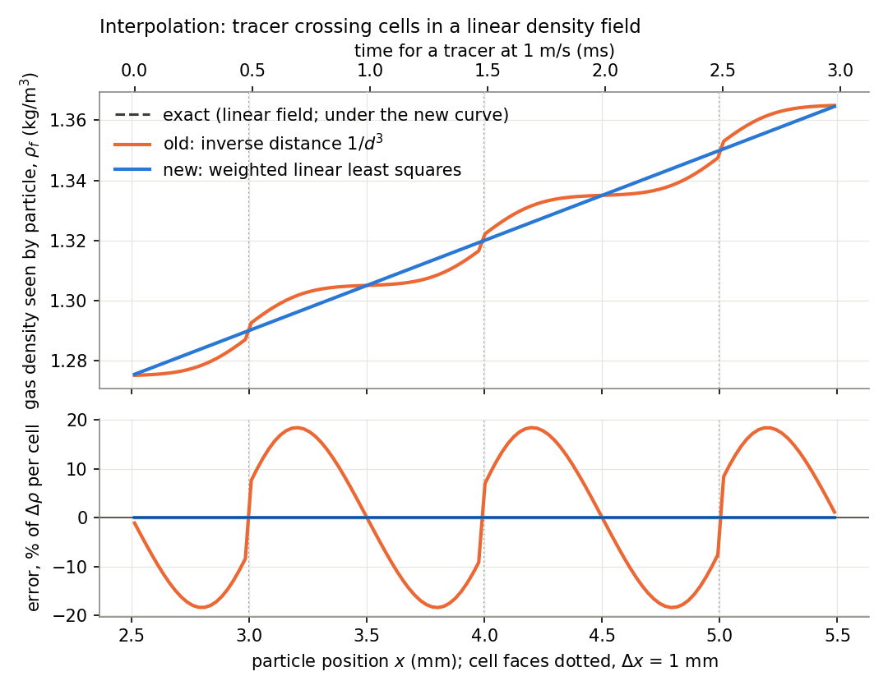

The old 1/d³ weighting pulled the value towards the nearest cell centre. The result was a
staircase with errors of up to ±18% of the density change across one cell, and it jumped
at every face. Weighted linear least squares (radius 1.8h) reproduces linear fields to
round-off, and its value is continuous as the particle crosses a face. Each cell also now
enters each bin's stencil only once; before, a two-bin periodic case counted some cells
twice.

### Interpolation in shock-driven flows

**Same instant, different places in the cells.** Stationary tracers sit at four fixed x
positions in a planar shock (Ms 1.27, 1 mm cells): one behind the shock and three inside
it. At each x they are stepped every 50 µm in y across four cells. The gas does not vary
in y, so all tracers at one x must read the same value.

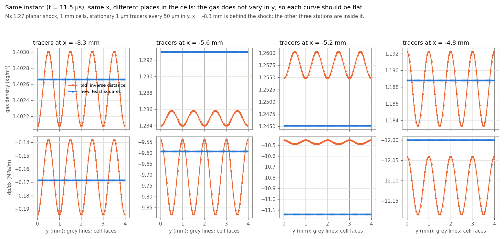

The old interpolation gives a wave with exactly the cell period: up to 0.7% peak to peak
in density and up to 33% in dp/dx. The new one is flat. This is the y-direction
counterpart of the interpolation figure above, where a particle moved along x.

The cause is the inverse-distance weighting. It weights each cell by its 3D distance from
the particle, so a particle near a y face, roughly equidistant from several cell centres,
gives more weight to the cells upstream and downstream of it in x than a particle at the
cell centre does. Wherever the gas varies in x, particles at different places in their
cells therefore read different values. Least squares fits a linear variation exactly,
wherever the particle sits.

**A particle sheet ripples with the old interpolation.** A flat sheet of identical
particles hit by a planar shock should stay flat: in a point-particle model nothing sets
one particle apart from another. In the LLNL sheet case (8,281 particles, dp = 150 µm,
Ms 1.27, cells 0.25 × 0.517 × 0.517 mm, run with the old code) it did not. The sheet sits
in one layer of cells, so the gas density, volume fraction and pressure gradient change a
lot from one x-cell to the next right at the sheet. Through the effect above, the
particles read gas density differing by up to 4%, volume fraction by up to 38% and dp/dx
by up to 40%, all from cells that are uniform in y and z to 0.4%. Particles on cell faces
lagged and particles in cell centres led, so the sheet rippled with the cell size as
wavelength; the standard deviation of the particles' x positions reached 193 µm
(1.3 diameters) by 0.5 ms.

A periodic slice of that case (4 × 4 cells across, 13 × 13 particles at 13 different
places in their cells, the same forces, two-way coupled) reproduces it:

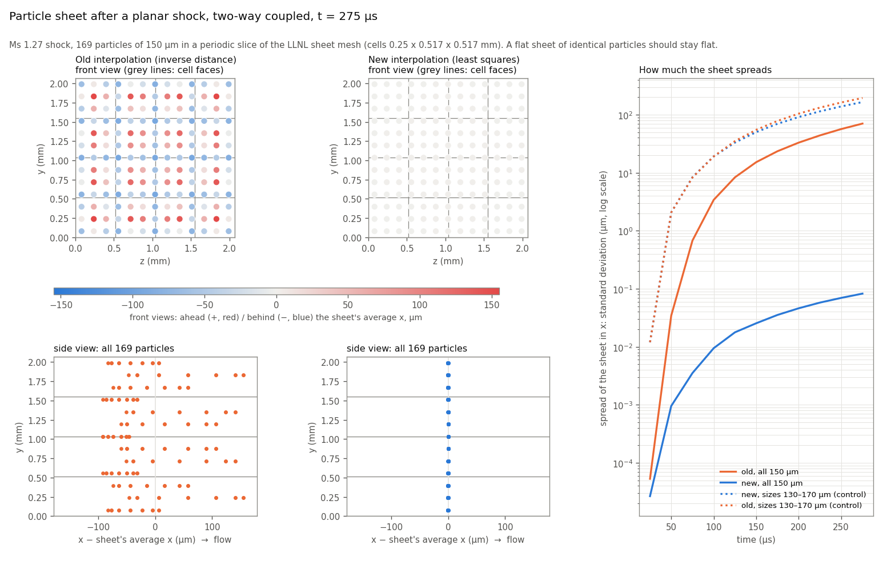

- **Front views (top):** the sheet seen face-on (z horizontal, y vertical), each particle
  coloured by how far it is
  ahead (red) or behind (blue) the sheet's average position. Old: a pattern tied to the
  cells. New: uniform.
- **Side views (bottom):** x horizontal (flow to the right), y vertical. Old: one bulge per cell. New: a
  straight line.
- **Right:** the spread of the sheet in x (standard deviation) over time, on a log axis.

| Spread of the sheet in x (standard deviation) | 100 µs | 150 µs | 200 µs | 250 µs |
|---|---|---|---|---|
| Old, one-way (`FEEDBACK 0`) | 2.2 µm | 11.2 µm | 24.9 µm | 42.8 µm |
| Old, two-way (`FEEDBACK 1`) | 3.4 µm | 15.2 µm | 33.1 µm | 56.6 µm |
| New, one-way | 0.09 µm | 0.24 µm | 0.48 µm | 0.78 µm |
| New, two-way | 0.01 µm | 0.03 µm | 0.05 µm | 0.07 µm |

The ripple appears with one-way coupling too, where the particles do not change the gas,
so it comes from the interpolation and not from the feedback.

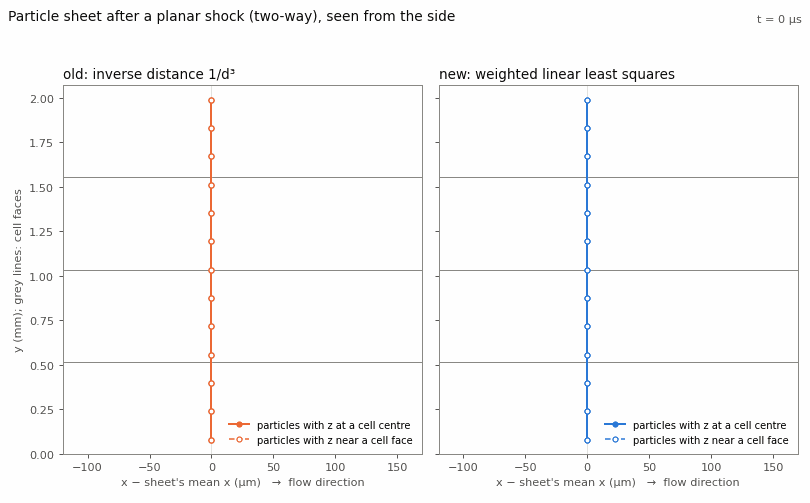

In the animation the solid line joins the particles whose z is at a cell centre, the
dashed line those whose z is near a cell face.

**Control: a sheet that must spread.** With diameters from 130 to 170 µm the particles
feel different drag (acceleration roughly as 1/dp), and the new interpolation spreads the
sheet as it should: the 130 µm particles end 426 µm ahead of the 170 µm ones at 250 µs.
The old run spreads a little more, because its cell-dependent push adds to the real one.
The two are independent, so they add roughly as √(a² + b²):

| t | New, mixed sizes | Old artefact alone (identical particles) | √(sum of squares) | Old, mixed sizes |
|---|---|---|---|---|
| 150 µs | 50 µm | 15 µm | 52 µm | 55 µm |
| 200 µs | 91 µm | 33 µm | 97 µm | 104 µm |
| 250 µs | 139 µm | 57 µm | 150 µm | 163 µm |

So the new interpolation removes only the part of the spreading that depends on where
particles sit in their cells. Where the real spreading is large, the old artefact was a
10–20% error on top of it; where it is small, as for identical particles, the artefact
was all of it.

**Shock profiles.** The gas seen by a line of stationary 1 µm tracers across a planar
shock (one-way), at two Mach numbers and two cell sizes:

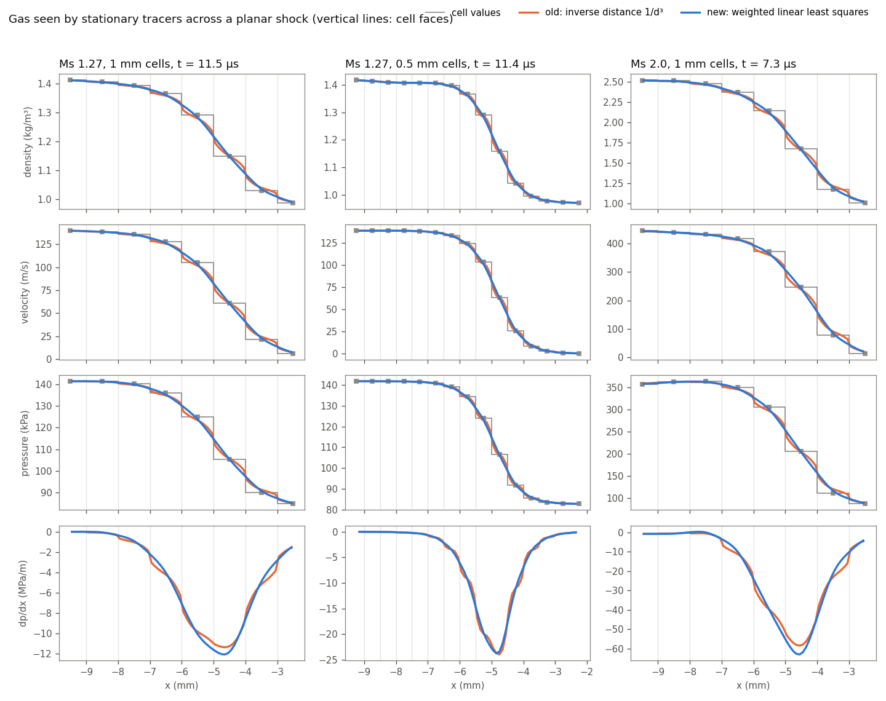

| Shock width 10–90% (density / pressure) | Cell values | Old | New |
|---|---|---|---|
| Ms 1.27, 1 mm cells | 3.69 / 3.29 mm | 3.86 / 3.67 mm | 3.49 / 3.31 mm |
| Ms 1.27, 0.5 mm cells | 1.94 / 1.91 mm | 1.99 / 1.99 mm | 1.92 / 1.92 mm |
| Ms 2.0, 1 mm cells | 3.77 / 2.86 mm | 3.68 / 3.00 mm | 3.32 / 2.81 mm |

"Cell values" is the straight line between neighbouring cell centres. Rocflu spreads the
shock over 3–4 cells, and that width halves with the cell size. Least squares follows the
cell profile and does not widen it (its support radius is 1.8 cells, but the fit is
linear). Neither method overshoots the range of the cell values. The old method has kinks
at every cell face, clearest in dp/dx (bottom row), so a particle crossing a face felt a
sudden change in its pressure-gradient force. Both methods converge to the same profile
when the cells are halved.

## Projection: kernel width per direction, and cloud-edge cells

A single particle is moved along x, and the panels show how its volume fraction φ is
shared among the cells (left) and the spread σ/Δl of that share (right). The top row uses
cube cells, the bottom row 2:1:1 cells.

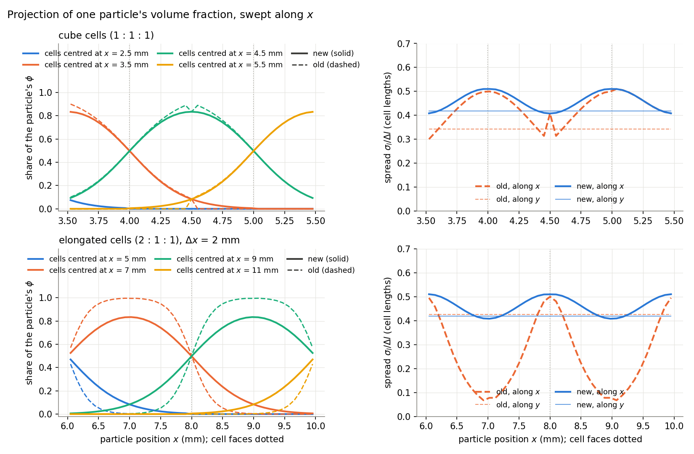

- On 2:1:1 cells the old spread along the long side fell to 0.07 cell lengths: the
  particle's φ landed almost entirely in one cell. The kernel now scales each direction by
  the receiving cell's length, as in MFC, and the spread stays between 0.41 and 0.51 cell
  lengths in every direction.
- On cube cells the old curve has a notch at the cell centre. Cells whose centre lay just
  outside the bin domain were dropped, so a particle reached only 8–12 cells instead of 27.
  The same bug made φ about 8% too high at the edge of a particle cloud.

The kernel width is still about 0.46h, so it depends on the mesh. How sensitive k_sg is to
this width is the next physics question (see [Still open](#still-open)).

## Low-slip closures

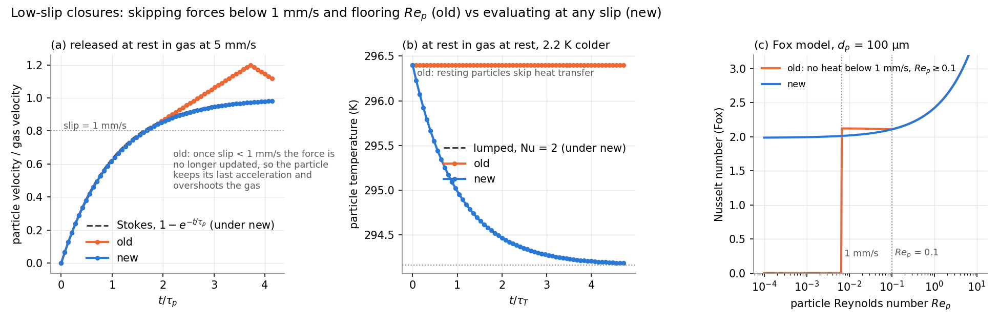

- **(a) Drag.** When the slip fell below 1 mm/s, the old code skipped the force update and
  kept its stale value. The particle went on accelerating and overshot the gas, reaching
  1.2 times the gas velocity. The new code follows the Stokes solution.
- **(b) Heat.** A particle at rest in gas at rest exchanged no heat at all. Its temperature
  now relaxes as the lumped model with Nu = 2 predicts.
- **(c) Fox Nusselt number.** The old code gave Nu = 0 below 1 mm/s and floored Re_p at
  0.1. The new formula tends smoothly to 2.

## Quasi-steady drag, aligned with MFC

Rows 1–2: C_D from each code's Fortran routine at M → 0 and φ = 0, compared with the
published correlations. Row 3: a particle released at rest in gas at 1 m/s (Re₀ = 1),
compared with the ODE using the published correlation.

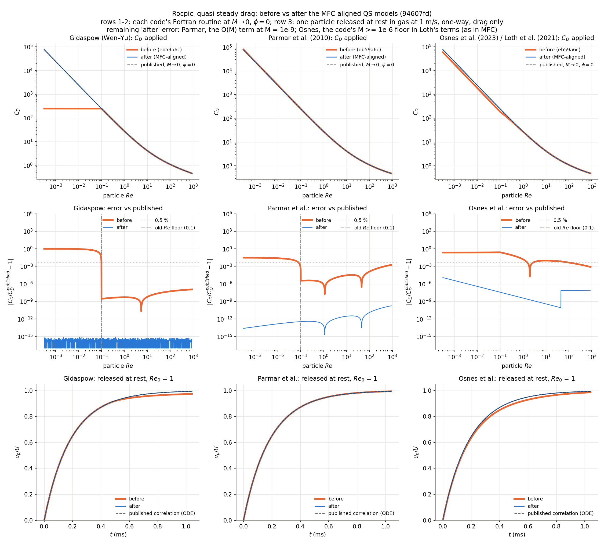

| Model | Worst error before | After |
|---|---|---|
| Gidaspow (Wen–Yu) | 100% (Re floored at 0.1 inside C_D) | 8e-16 |
| Parmar et al. (2010) | 3% | 2e-10 |
| Osnes et al. (2023) / Loth et al. (2021) | 25% (M floored at 0.01, giving a spurious Knudsen reduction) | 1e-5 |

The remaining "after" errors come from evaluating at M = 1e-9 and from the code's own
M ≥ 1e-6 floor in Loth's terms, which MFC also has. The modified Parmar model was removed.

> **Input decks:** `QSFORCE` now follows MFC: 0 none, 1 Gidaspow, 2 Parmar, 3 Osnes.
> 4 stops with an error. Decks that used `QSFORCE 2` for Osnes must change to `3`.

## Particle collisions

Collisions use a soft-sphere model: overlapping particles push each other apart with a
spring and a dashpot. The spring stiffness is the softer of two values:

- **k₁ = m_eff (π² + ln² e) / (KSP·dt)²**. With this stiffness a contact lasts exactly
  KSP time steps and rebounds with restitution e = `EREST` (the linear model in MFC's
  `m_collisions`). dt is the current time step, so the contact time follows dt.
- **k₂ = (4/3) E\* √(R\*) √δ**, the Hertz stiffness at overlap δ, with E = 1 GPa and
  ν = 0.35 for every particle.

The dashpot is set from the chosen stiffness so that a linear contact rebounds with e.

### Contact stiffness from the pair's effective mass (3afd23a)

k₁ used particle i's own mass instead of the pair's effective mass m₁m₂/(m₁+m₂). With
unequal masses each particle of a pair used a different stiffness (and could pick a
different branch of min(k₁, k₂)), so the two contact forces were not equal and opposite.
An 8:1 pair at 2 m/s kept 33% of its momentum; at 20 m/s its total momentum reversed. For
equal masses k₁ was twice the intended value, and contacts lasted about 0.72·KSP steps
instead of KSP.

The test case `box/binary-collisions` (np 1, 2, 4) collides four pairs across a bin face,
a rank border and the periodic faces. Particles start with an initial velocity, which
`points.dat` now accepts as `material x y z dp u v w` (786ecb1).

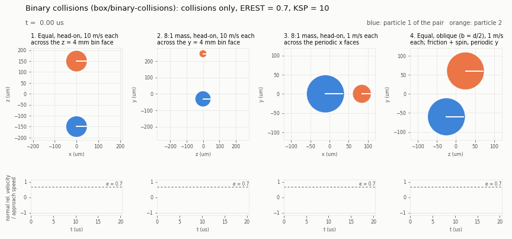

Each panel follows one pair around its centre of mass, drawn to scale, with x horizontal
and y vertical (z takes the place of the missing one). The line on each
particle turns with its spin. Below each panel, the normal relative velocity divided by
the approach speed rebounds to e = 0.697 for the head-on pairs (EREST = 0.7). Momentum is
conserved to 1e-5 and angular momentum about the centre of mass to 0.5%, including in
the oblique pair (panel 4), where friction sets both particles spinning.

### Ghost particles and the neighbour search (f7a3980, 0bb2e4b, 82d4ca4)

A particle near a bin face is sent to the neighbouring bins as a ghost, so that pairs
across bins, ranks and periodic faces are found. The ghost algorithm was compared with
Sam's ppiclF: ghosts carry the whole state vector, velocity included. A test build whose
ghosts dropped the velocity fails the new case `box/ghost-collisions` on 1, 2 and 4
ranks; the current code passes it. The subbin neighbour search was compared with a brute-
force search over all real and ghost particles (scratch build) and found every pair on
1, 2, 4 and 8 ranks.

The animation shows ghosts at work in a periodic 8 mm box on 4 ranks (collisions only,
100 µm particles at 10 m/s each). Three pairs start on opposite edges of the box and
collide through a periodic boundary: head-on across the x faces (both particles on one
rank), obliquely across the y faces (the partner is on another rank, since the bins are
split in y), and along the diagonal through the periodic corner (x, y and z faces at
once). In the close-ups, each real particle (solid) meets the ghost of its partner
(dashed): the partner's copy shifted by one box length. Both particles of a pair rebound
with e ≈ 0.71 (the oblique pair 0.75, leaving with 66,600 rad/s of spin), and each pair's
momentum is unchanged.

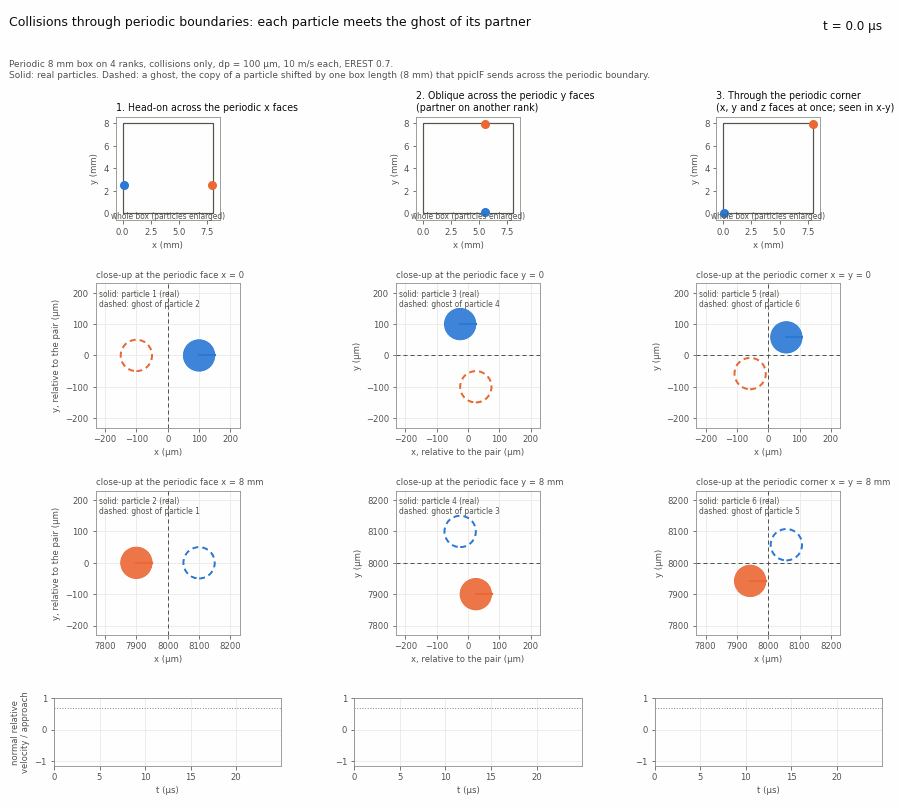

Two robustness fixes came with this:
- Sending or receiving more ghosts than `PPICLF_LPART_GP` wrote past the end of the ghost
  arrays. The run now stopped with a message; since e227f99 the ghost arrays grow instead
  (see [Memory](#memory-ppiclf-arrays-sized-at-run-time-c1ac692-0d4d86c-e227f99)). Ghosts no longer carry the projection values,
  which shrinks the ghost arrays by 30% (about 520 to 360 MB per rank at LPART = 80000).
- The subbin contents were dense tables of (subbins × particles) 4-byte integers. A 2 cm
  bin with 0.4 mm subbins has 140,608 subbins, so 50,000 particles requested about 28 GB
  per call. They are now compact lists: one start index per subbin plus three integers
  per particle, about 1.2 MB for the same bin (12 bytes more per ghost), about 24,000
  times less. The interpolation stencil search had the same kind of table over cells, which
  grew with the square of the cells per bin; it uses the same lists now. Results are
  byte-identical.

## Particle–wall collisions (2ff0cd8)

### Turning walls on

A slip-wall or no-slip-wall section of the `.bc` file with `PARTWALL 1` makes that patch
a particle wall:

```
# BC_SLIPW
PATCH     1 2
NAME      SlipWall
PARTWALL  1     ! particles collide with these patches (default 0)
#
```

Patches without the key, and periodic patches, are not particle walls, so periodic runs
are unchanged. At start-up every rank gets every face of these patches, with
quadrilaterals split into two triangles. Their normals come from Rocflu and point into
the fluid. At start-up the code prints how many triangles came from which patches, and
warns if `COLLISIONS` is 0 (the walls then have no effect).

`filein.vtk` is no longer read, and a run that finds one in its directory stops with a
message. Its triangles had no known fluid side (in the cone file, for example, half of
them point each way), it had to be kept consistent with the mesh by hand, and walls that
the gas sees are exactly the fluid mesh walls. A deck that used it needs `PARTWALL 1` on
its wall patches instead.

### What changed

- **Same force law as pairs.** The pair contact force is now one routine
  (`ppiclf_user_ContactForce`) used by pairs and walls. The wall is a partner of infinite
  mass and radius at rest: m_eff = m, R\* = r, same E, ν, EREST, KSP, friction and rolling
  torque. Pair results are byte-identical to before. The old wall branch had its own Hertz
  constant (√2 too soft for a wall of the same material), no ln² e term in k₁, no
  friction, and started the contact 0.05·dp before the particle touched the wall.
- **Closest point on each triangle.** The old search projected the particle onto each
  triangle's plane and accepted the triangle if the projection was inside it (with 10%
  slack). Near the edge between two triangles both accepted it, and the particle was
  pushed twice. The contact now uses the closest point on each triangle (face, edge or
  vertex). Repeated contacts are dropped, so a flat wall made of many triangles acts as
  one surface, and edges and corners between walls are handled.
- **A fluid side.** A patch wall pushes a particle back towards the fluid even when the
  particle's centre has crossed the wall. The old wall turned its normal towards whichever
  side the centre was on, so once the centre crossed, the wall pushed it out of the domain.
  This assumes that the solid behind a `PARTWALL` patch is at least `NEIGHBORWIDTH` thick
  (at least 4 diameters), which holds for the boundary of the fluid domain.
- **Search.** Wall triangles are filed into the collision subbins of each rank, so a
  particle only checks the triangles near it. The old code checked every wall for every
  particle.
- **Particles just outside the domain.** ppiclF cut its bins back to the fluid domain's
  extent in every direction. A particle whose centre was briefly outside the domain was in
  no bin: it was dropped on 2+ ranks, and on 1 rank the subbin index went below 0 and the
  run crashed. Bins are now only cut back in periodic directions.

### Results

The probe below fires particles (dp = 100 µm, COLLISIONS 1, EREST 0.7, KSP 10) at the
walls of a closed 8 mm box with gas at rest. The gas CFL sets dt ≈ 1.9e-7 s, so a contact
governed by k₁ lasts about 1.9 µs. The old code reads the walls from a `filein.vtk` of the
box (two triangles per face); the new code uses the box's slip walls with `PARTWALL 1`.

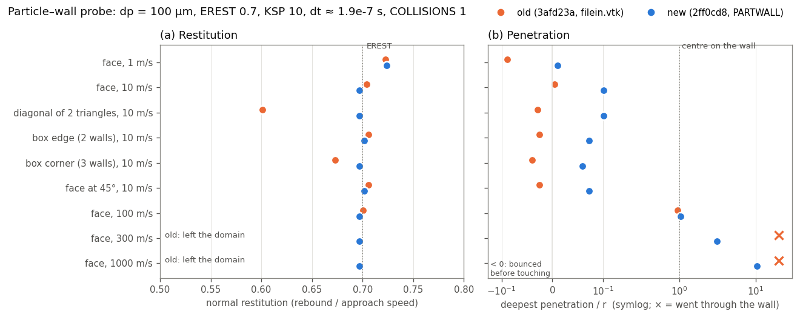

- **(a)** The new code rebounds with e = 0.697 on faces, on the diagonal between two
  triangles, at a box edge and in a corner, the same value as a head-on pair. At 1 m/s
  the Hertz stiffness is the softer one and e = 0.724. The old code gave 0.60 on the
  diagonal and 0.67 in the corner, where triangles pushed twice.
- **(b)** At 100 m/s the centre reaches the wall plane (penetration 1.0 r). At 300 and
  1000 m/s the old wall let the particle through and the run crashed; the new wall pushes
  it back from 3.1 r and 10 r behind the wall, with the same e.

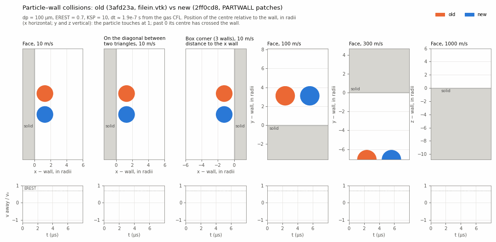

Each panel looks along the wall. The axis normal to the wall is the position of the
particle's centre relative to the wall in radii (horizontal for the x walls, vertical for
the y and z walls): the particle touches at 1 and its centre has crossed the wall past 0. Old (orange) and new (blue) particles are drawn to scale side by side, and
the strip below shows the velocity away from the wall over the approach speed. One
frame is one time step.

**How deep particles go.** With the k₁ stiffness the deepest penetration is about
v·KSP·dt/π, whatever the material: about 3.7 r for a 100 µm particle at 300 m/s with
KSP 10 and dt = 1.9e-7 s. The new wall recovers such particles, but the contact is not
resolved in any physical sense. Keeping v·KSP·dt/π well below the radius needs a smaller
KSP or a smaller time step. Rocflu's time step does not take particle speeds into account.

The test case `box/walls` (np 1, 2, 4) runs eight such shots with COLLISIONS 2 (friction
and spin). Each particle that hits one wall must rebound with e within 0.035 of EREST,
every particle must end inside the box, and 2 and 4 ranks must match 1 rank. The old code
fails it: the 300 m/s particle leaves the domain and the run crashes. At an edge or a
corner each wall's friction also slows the motion towards the other walls (e ≈ 0.55 at
the edge, 0.47 in the corner with μ = 0.4), so there the test only checks the rebound.

## Memory: ppiclF arrays sized at run time (c1ac692, 0d4d86c, e227f99)

### The problem

ppiclF kept its data in Fortran COMMON blocks whose sizes were fixed when the code was
compiled, in `libpicl/user_files/PPICLF_USER.h`:

| Setting | Value | What it sized |
|---|---|---|
| `PPICLF_LPART` | 80,000 | Particles on one rank: the state `y`, `rprop`, `feedbk`, `iprop`, the neighbour-search copy and the send buffer for particles changing rank |
| `PPICLF_LPART_GP` | 8 × `LPART` = 640,000 | Ghost particles on one rank |
| `PPICLF_LEE` | 120,000 | Fluid cells on one rank, and cells overlapping one rank's bins |
| `PPICLF_LWALL` | 50,000 | Particle-wall triangles |
| `PPICLF_VU` | 50 | Steps of viscous-unsteady history per particle (500 values each, stored three times) |

Every rank reserved all of it, whatever the run needed, and the zeroing at start-up
touched every page:

- A shock-tube run with **one particle on 640 cells used 1.34 GB** of memory (peak
  resident set). The viscous-unsteady history alone took about 900 MB of it, even with
  `VISCOUSUNSTEADY 0`.
- A rank that needed more than the fixed sizes stopped ("Increase LPART", "increase
  PPICLF_LPART_GP", "Increase LEE"), and the code had to be recompiled.
- With `PPICLF_VU 0` (to save memory) and `VISCOUSUNSTEADY 1` in the input, the history
  routines wrote past the end of zero-length arrays.
- One limit was not checked at all: when a rank's bins overlapped more than `PPICLF_LEE`
  fluid cells, the extra cells were dropped on receive without a message (see below).

### What changed

The change was made in three steps, each built and run through the whole regression
suite twice before the next one:

1. **c1ac692: the viscous-unsteady history.** The history arrays and `rprop3` (the same
   history packed per particle, so that it moves with a particle that changes rank) became
   allocatable, in module `ppiclf_unsteady` (`ppiclf_unsteady.f`). They are allocated at
   start-up only when `VISCOUSUNSTEADY ≥ 1`, with as many steps as the new PICL key
   `VUSTEPS` (default 50, the old `PPICLF_VU`). `PPICLF_VU` and `PPICLF_LRP3` are gone.
   `DU HEATTRANSFER` is computed in the same routines, so it now needs
   `VISCOUSUNSTEADY ≥ 1`; before, it was silently zero without it.
2. **0d4d86c: move the arrays into a module.** Every array sized by `LPART`, `LPART_GP`,
   `LEE` or `LWALL` moved from the COMMON blocks (`PPICLF_SOLN.h`, `PPICLF_PARALLEL.h`,
   `PPICLF_GRID.h`, `PPICLF_GEOM.h`) into module `ppiclf_data` (`ppiclf_data.f`) as an
   allocatable array. Every routine that includes `PPICLF` got a `use ppiclf_data` line.
   The sizes were still the old fixed values, so this step changed only where the memory
   lives; results were bit-for-bit the same.
3. **e227f99: size from the run, and grow.** The fixed sizes are gone. Each group of
   arrays has a capacity (`ppiclf_maxpart`, `ppiclf_maxghost`, `ppiclf_maxcell`,
   `ppiclf_maxfv`, `ppiclf_maxwall`) that starts at 1 and grows whenever a count would
   exceed it.

The modules and allocatable arrays are standard Fortran 90; the files stay in fixed form
(72 columns), which gfortran compiles as before. The module files (`.mod`) are written to
`libpicl/build/`.

### How the arrays grow

The number of particles on a rank changes during a run: ppiclF assigns particles to ranks
by spatial bins, and a cloud that is compressed or swept downstream piles into fewer
bins. The counts only go up in a few places, and each one now makes room first:

| Count | Where it grows | How |
|---|---|---|
| Particles | `AddParticles` (start-up), the restart reader, `MoveParticle` (particles changing rank) | `ppiclf_data_GrowPart`, which also grows the viscous-unsteady history |
| Ghosts | `CreateGhost` (ghosts to send), `MoveGhost` (ghosts received) | `ppiclf_data_GrowGhost` |
| Cells overlapping the bins | `MapOverlapGrid` (cells to send and received), the interpolation and projection transfers | `ppiclf_data_GrowCell` |
| Fluid cells of this rank | `InitOverlapGrid` | `ppiclf_data_GrowFV`, exact: Rocflu passes its cell count |
| Wall triangles | `AddWall` | `ppiclf_data_GrowWall` |

A capacity grows to what is needed, and by at least 1.5 times, so a count that creeps up
reallocates rarely (from 1 to 100,000 takes about 30 steps over a whole run). Growing
copies the existing entries into the larger array; it never shrinks.

**Transfers between ranks.** Particles, ghosts and cells move between ranks through
gslib's crystal router. If a rank receives more than its arrays hold, the router keeps what
fits, drops the rest, and only reports the full count afterwards; growing after the
transfer would be too late. So before each of the five transfers, `ppiclf_comm_NumIncoming`
counts the columns each rank sends to each other rank and adds them up with one
`MPI_Reduce_scatter_block`, which tells every rank how many it will receive. The rank grows
its arrays to that number, then the transfer runs. Each transfer still checks the received
count afterwards, as a guard that should never trigger.

**Restart.** The particle reader used to fill the first ranks with `PPICLF_LPART`
particles each. It now gives every rank an equal block, ⌈total / ranks⌉, the same split
Rocflu uses for `points.dat`; ppiclF then moves the particles to the ranks that own their
bins, as before. (Restart itself is still unverified; see [Still open](#still-open).)

### Two bugs found on the way

- **Cells dropped without a message (`MapOverlapGrid`).** Only the number of cells a rank
  *sent* was checked against `PPICLF_LEE`; the number it *received* was not. A rank whose
  bins overlapped more than 120,000 fluid cells lost the extra cells, so particles near
  them interpolated from, and projected onto, an incomplete stencil. Now the cell arrays
  grow before the transfer.
- **`points.dat` read one column past the rank's share (`PICL_TEMP_InitSolver`).** Every
  line of `points.dat` is read on every rank, to get the global bounding box, but the
  position was read straight into the rank's particle buffer `y(:,i)`. Once a rank had its
  share, the remaining lines went into column `npart_local + 1`. That was harmless while the
  buffer had 80,000 columns; with a buffer of exactly the rank's share it corrupted memory
  and the 2- and 4-rank cases crashed at exit. The position is now read into a local
  variable and copied only for the rank's own particles. Valgrind found this one.

### How it was checked

- **Regression suite:** 35 PASS, twice, after each of the three steps, with the goldens
  unchanged. Since every capacity starts at 1, every case grows its arrays many times (on
  1, 2 and 4 ranks, with ghosts across ranks and periodic faces), so the growth paths are
  covered by the whole suite.
- **Valgrind** on `box/ghost-collisions/np4` and `box/walls/np4` (4 ranks, ghosts growing
  and moving between ranks): no invalid reads or writes.
- **Beyond the old limit:** 120,000 particles on one rank (the old limit was 80,000)
  run to the end, and all 120,000 are in the particle output.
- **Memory**, shock tube with one particle on one rank (peak resident set):

| Build | Memory |
|---|---|
| Before (fixed arrays, 50-step history) | 1,342 MB |
| c1ac692 (history only when `VISCOUSUNSTEADY ≥ 1`) | 807 MB |
| e227f99 (everything sized from the run) | 265 MB |

Most of the remaining 265 MB is Rocflu and MPI. The fixed-size data of the solver
executable `rflump` (its `bss` segment) went from 1.8 GB to 0.5 MB. With `VISCOUSUNSTEADY 1` the history is allocated as
before, per particle (about 12 kB per particle for 50 steps).

### What changes for users and developers

- `PPICLF_USER.h` no longer has `PPICLF_LPART`, `PPICLF_LEE`, `PPICLF_LWALL`, `PPICLF_VU` or
  `PPICLF_LRP3`. There is nothing to raise for a larger run.
- `VUSTEPS` in the PICL section sets the length of the viscous-unsteady history.
- The spare property arrays `rprop2`, `rprop4`, `rprop5` (`PPICLF_LRP2/4/5`, all 0) and the
  unused "store forces" block that wrote `rprop5` are gone, and so is
  `ppiclf_user_InitZero`: the history is allocated with the other arrays in
  `ppiclf_data_Allocate` and zeroed in `ppiclf_solve_InitZero`.
- A new per-particle array goes in module `ppiclf_data`: declare it, allocate it in
  `ppiclf_data_Allocate`, and add it to `ppiclf_data_GrowPart`. Routines that use it need
  `use ppiclf_data` (every routine that includes `PPICLF` already has it).
- Arrays whose size is a particle, ghost or cell count must not be given a fixed size
  anywhere else (local buffers included): size them from the current count or capacity.

## Particle properties (`rprop`)

`ppiclf_rprop(:, i)` holds everything about particle `i` that is not in the state
`y`. It had 59 slots doing four different jobs, in no particular order, and all of them
moved with the particle, went to every ghost, were written to every `par*.vtu` file (as
`rpro01` to `rpro59`) and were read back on restart. Before the changes below:

| Job | Slots (old numbering) | Needed |
|---|---|---|
| Particle properties | 1 ρp, 3 dp, 4 Vp, 22 superparticle loading | Every step, and on restart. Set once in `PICL_TEMP_InitSolver` |
| Carried from step to step | 25–27 quasi-steady force fluctuation, 46–48 ξ∥, ξ⊥, ξT | Every step, and on restart: each step updates the previous value |
| Gas values at the particle | 2, 5–19, 24, 31–33, 36–45 (30 slots) | During the step only: Rocflu interpolates them before every stage. Slot 36 (gas pressure) is never read |
| Read from neighbours | 28–30 Ẇ | Added mass (`AMFORCE 2`) reads it from neighbouring particles, ghosts included |
| Diagnostics | 23 (\|v\|), 49–59 (pseudo-turbulence terms) | Output only |
| Unused | 20 (never written), 21 (written from a hard-coded 50 µm, never read), 34, 35 (freed when the burn-rate model was removed) | |

Planned, one commit at a time:

1. Ghosts carry only what the neighbour search reads (done, below).
2. Choose the fields of the particle output with a list, and name them (done, below).
3. Remove the unused slots and group the rest by job (done, below).
4. Later: a separate double-precision particle restart file holding only the state a
   run needs to continue, as MFC does. Until then a particle restart stops (below).

### Ghosts carry only what the neighbour search reads (a7f5748)

A ghost carried `y` and all of `rprop`: 69 doubles. The neighbour routine
(`ppiclf_user_EvalNearestNeighbor`) reads only dp, ρp, Vp and Ẇ from its neighbour, so a
ghost now carries `y` and those 6 slots: 16 doubles, 128 bytes instead of 552, in memory
and in the ghost transfer.

- The slots are listed once, in `PPICLF_USER.h`:
  `PPICLF_LRP_GHOST` (how many) and `PPICLF_GHOST_SLOTS_INDEX` (which). Module `ppiclf_data`
  turns the list into the array `ppiclf_ghost_slots`.
- `ppiclf_comm_CreateGhost` packs those slots after `y`.
- The neighbour search unpacks a ghost's slots into a full-length local `rpropj` before
  calling the user routine, so the routine's interface is unchanged. Slots a ghost does
  not carry are zero.
- `ppiclf_cp_map`, the real particles' copy, keeps all of `rprop`: particle `i`'s own
  values (`rpropi`) and the wall contacts read more than these 6 slots.
- **If the neighbour routine starts reading another slot from `rpropj`, add it to
  `PPICLF_GHOST_SLOTS_INDEX`.** Otherwise a ghost passes zero for it, and only pairs across a
  rank boundary or a periodic face are wrong.

Checked: all 35 suite cases, plus `AMFORCE 2` versions of the ghost-collision (1, 2 and 4
ranks) and binary-collision (2 and 4 ranks) cases, write byte-identical particle and flow
files before and after. Ẇ is non-zero in those runs, so the ghosts' Ẇ is used. The suite
itself has no `AMFORCE 2` case across ranks.

#### What it saves

Each ghost is 584 bytes before and 160 bytes after: its reals (69 or 16 doubles) plus 8 integers
(`iprop_gp`: tags, bin, destination rank). That is 3.65 times less to hold and to send.

Measured on a periodic 8 mm box with a 37³ lattice of particles (50,653 particles,
dp = 100 µm, about 5% by volume, 16³ cells), collisions on, 155 steps (480 ghost exchanges, one per
RK stage), one 16-core node, 3 runs of each build alternating. The two builds are 74b8f87
and a7f5748 with the same temporary timers: a barrier, then `CreateGhost`, a barrier, then
`MoveGhost`, a barrier. The barriers keep a rank's wait for slower ranks out of the timers.

| Ranks | Ghosts per rank (real particles per rank) | Ghost exchange, 480 calls: before → after | Ghost data sent per rank per exchange | Ghost arrays per rank | Peak memory per rank | Whole run |
|---|---|---|---|---|---|---|
| 4 | 7,181 (12,663) | 3.0 s → 1.35 s | 4.2 → 1.15 MB | 7.1 → 1.9 MB | 209 → 200 MB | 138.6 → 135.6 s |
| 8 | 4,316 (6,332) | 3.5 s → 1.7 s | 2.5 → 0.69 MB | 3.2 → 0.86 MB | 172 → 166 MB | 86.9 → 86.1 s |
| 16 | 3,126 (3,166) | 2.9 s → 1.7 s | 1.8 → 0.50 MB | 3.2 → 0.86 MB | 164 → 160 MB | 63.5 → 62.1 s |

Times are medians of the 3 runs; the ghost exchange varied by up to ±0.6 s between runs.

- **The transfer (`MoveGhost`) is 2.4 to 3.2 times faster** (2.25 → 0.78 s on 4 ranks), close to
  the 3.65 times fewer bytes. Building the ghosts (`CreateGhost`) changes little: it still copies
  all of `rprop` into `cp_map`. The exchange as a whole takes about half the time.
- **The whole run is 1–2% faster**, because the ghost exchange is only about 2% of this run.
  Most of the time is in the neighbour search, the forces and the fluid solver.
- **The memory saved grows with the number of ghosts**: 424 bytes per ghost the rank can hold
  (its capacity), plus the same again for the copies gslib makes while sending. A rank has many
  ghosts when its bins are small next to the neighbour distance: on 16 ranks here a rank holds
  about as many ghosts as real particles, and a dense production run on many ranks can hold
  more ghosts than real particles. For example, a rank with 10⁶ ghosts saves about 0.4 GB.
- Everything runs on one node, so the transfer is a memory copy. Across nodes the network
  carries 3.65 times fewer bytes, so the saving should be at least as large there.

The case and scripts are in `tests/_work/bench` (not tracked): `bench_setup.py` makes the case,
`bench_run.sh` runs it and `analyze.py` reads the `GHOSTT` lines the timed builds print.

### Particle output: a list of named fields

Being in `rprop` and being written to the particle files are now separate questions.
The writer (`ppiclf_io_WriteParticleVTU`) used to write all of `y`, all 59 `rprop`
slots and the 3 tags, as `y01`…, `rpro01`… and `tag01`…. It now writes the fields of
a list, built once by `ppiclf_user_OutputFields` (`libpicl/user_files`). Each entry
is a slot of `ppiclf_y`, `ppiclf_rprop` or `ppiclf_iprop` and the name it is written
under. A slot that is not in the list is still computed and used; it is only not
written. Positions are always written, as the points of the file.

| Group | Fields | Written when |
|---|---|---|
| Default | `vp_x vp_y vp_z` (particle velocity), `phi_p` (particle volume fraction: the projected particle volume, interpolated back to the particle), `dp`, `id id_rank id_cycle` (index on the rank that created the particle, that rank, the cycle it was created on) | Always |
| Particle | `Tp`, `omp_x omp_y omp_z` (spin), `rhop`, `volp` | `OUTPARTICLE 1` |
| Gas at the particle | `rho_g`, `ug_x ug_y ug_z`, `c_g` (sound speed), `T_g` | `OUTGAS 1` |
| Gas gradients at the particle | `dpdx_g …`, `DuDt_g_* `, `drhophidt_g`, `drhophidx_g …`, `vort_g_*`, `drhodx_g …`, `divtau_g_*`, `DvortDt_g_*` | `OUTGRADGAS 1`, for checking the interpolation |
| Models | `Ffluct_*` (with `QSFLUCT`), `Wdot_*` (with `AMFORCE 2`), `xi_par xi_perp xi_T` and the 11 pseudo-turbulence diagnostics (with `PSEUDOTURB`) | `OUTMODEL 1`, for the models that are on |

- The four keys go in the `# PICL` section; all default to 0. No key is the start of
  another, because Rocflu's `ReadSection` matches the start of each input line (a key
  `OUTGAS` would also match a line `OUTGASGRAD 1`).
- The superparticle loading (always 1 for now) and the unused slots are not written.
- To add a field: one `call ppiclf_io_AddOutputField(source, slot, 'name')` in
  `ppiclf_user_OutputFields`, inside the group it belongs to. The call stops the run if
  the slot is out of range, the name is empty, longer than 24 characters or used twice,
  or the list is longer than 80 fields.
- File size: each particle used to take 300 bytes per file (3 position values and 72
  fields of 4 bytes); with the default fields it takes 44 bytes, 6.8 times less. For the
  4-particle shock tube: 9,395 bytes before, 1,807 with the default fields and 5,860 with
  the three groups the regression suite turns on.

**Particle restart stops for now.** A restart used to read `y` and all of `rprop` back
from the last `par*.vtu` file, in file order. The files now hold only the output fields
(in single precision, which a restart should not use anyway), so a restart stops at
start-up with *"Particle restart is not available yet"* until the separate restart file
exists. A new run (no `.rin` file) is unaffected.

**Regression suite.** The template input turns on `OUTPARTICLE`, `OUTGAS` and
`OUTGRADGAS`, so the goldens keep checking the same quantities. The harness and the 32
goldens with particles use the new names; the conversion renamed keys only (8,790
values compared, none changed) and dropped the superparticle loading, which was 1.0 in
every golden. Checked: in all 37 cases with particles (the 35 suite cases plus
`AMFORCE 2` variants with `OUTMODEL 1`), every named field is bit-identical to the
field it replaces in the files of 74b8f87 (e.g. `rho_g` to `rpro02`), and the flow
files are byte-identical. The default output alone and `OUTMODEL` with `QSFLUCT` and
`PSEUDOTURB` were also run.

### Unused slots removed, the rest grouped by job

`PPICLF_LRP` is 53 (was 59) and `PPICLF_LRP_INT` 29 (was 30). The `PPICLF_R_*` names are
unchanged; only their numbers moved, so each job is one block (`PPICLF_USER.h`):

| Slots | Job | Contents |
|---|---|---|
| 1–4 | Particle properties | `JRHOP`, `JDP`, `JVOLP`, `JSPL` |
| 5–13 | Model state carried from step to step | `FLUCTFX/Y/Z`, `XIPAR/XIPERP/XIT`, `WDOTX/Y/Z` |
| 14–42 | Gas at the particle, interpolated every stage | `JRHOF`, `JPHIP`, `JUX/Y/Z`, `JCS`, `JT`, `JDPDX/Y/Z`, `JSDRX/Y/Z`, `JRHSR`, `JPGCX/Y/Z`, `JXVOR/Y/Z`, `JRHOGX/Y/Z`, `JDPVDX/Y/Z`, `JSDOX/Y/Z` |
| 43–53 | Pseudo-turbulence diagnostics | `RTildePar` … `RTerm2Perp` |

Removed:
- `JDPi` (never written) and `JDPe` (rewritten every step as 50 µm/\|v\| × dp, a
  leftover "axisymmetric collision correction" that nothing read).
- `JSPT`, the particle speed \|v\| stored "for plotting"; it only fed `JDPe`. ParaView
  computes it from `vp_x vp_y vp_z`.
- `JP`, the gas pressure: Rocflu computed it and ppiclF interpolated it every stage,
  and nothing read it. Its array (`ppF`) and its `InterpFieldUser` call are gone from
  `PICL_TEMP_Runge.F90` and `PICL_TEMP_Runge_EulerPT.F90`, and the check there that the
  number of interpolated fields matches `PPICLF_LRP_INT` now expects 29.
- Slots 34 and 35, empty since the burn-rate model was removed.

Each particle now stores 48 bytes less in `rprop`, and the same again in the
neighbour-search copy (`cp_map`) and in every transfer of a particle to another rank.
One field less is computed, sent between ranks and interpolated every stage.

**Adding a slot:** put it in the block of its job and renumber the rest of that block
and the blocks after it; nothing in the code uses slot numbers directly, only the
`PPICLF_R_*` names. Update `PPICLF_LRP`, and for an interpolated field `PPICLF_LRP_INT`
and the check in the two `PICL_TEMP_Runge*.F90` files.

Checked: 35 PASS twice; in all 39 cases with particles (the suite, `AMFORCE 2` variants,
and `QSFLUCT` and `PSEUDOTURB` variants with `OUTMODEL 1`, 62 fields) every named field is
bit-identical to the old field it replaces in the files of 74b8f87, and the flow files
are byte-identical.

## Notes for the discussion with the MFC team

- **The normal force turns attractive at the end of a contact.** The normal force is
  −k δ − η v_n. While the particles separate, v_n changes sign, and near the end of the
  contact the dashpot term exceeds the spring term. The animation of the binary
  collisions shows a pull of 1–2% of the rebound speed. MFC's `m_collisions` has the same
  form. The usual fix allows only repulsive normal forces (clip at 0, as in LIGGGHTS).
  Clipping removes some damping, so the actual e comes out above EREST unless η is
  recalibrated (linear spring–dashpot, Schwager & Pöschel 2007):

  | EREST | e with clipping |
  |---|---|
  | 0.5 | 0.550 |
  | 0.7 | 0.718 |
  | 0.9 | 0.902 |

  The friction and rolling torques use |F_n|, so they also act during the attractive
  phase. The code keeps the unclipped force for now, as in MFC.
- **min(k₁, k₂).** MFC uses only the linear spring–dashpot (k₁). ppiclF takes the softer
  of k₁ and the Hertz stiffness. In the Hertz branch e depends on the impact speed (0.725
  for an equal pair at 2 m/s).
- **Material constants.** E = 1 GPa and ν = 0.35 are fixed in the code for every particle
  and wall. Aluminium is about 70 GPa.
- **Resolution.** KSP·dt sets the contact time, so fast impacts penetrate by
  v·KSP·dt/π (see above). A time-step limit from the particle speeds would bound it.

## MPI and periodic boundaries

These fixes have no figure. Each is checked by a regression case that compares 1, 2 and
4 ranks and checks the conservation budgets.

- **Stale virtual cells at rank borders (e3ed370).** `PICL_TEMP_InitSolver` converted the
  conserved variables before virtual cells had φ, and did not exchange them again. A
  quiescent particle cloud set the gas in motion, and results differed by 1% between 1 and
  2 ranks. φ and k_sg are now exchanged before the virtual-cell state is computed in every
  stage.
- **Periodic and symmetry patches (11dc640).** Virtual cells used their own gradients, so
  the fluxes through these patches did not cancel. Gradients are now exchanged
  (`RFLU_MPI_ExchangeGradCells`) and transformed (`RFLU_RELP_TransformGradWrapper`).
- **Uninitialized reads (b10c5f1).** k_sg was missing in the `VELTEMP` inflow branch, which
  gave NaN on 2+ ranks. Also fixed: PICL arrays zeroed, NSCBC patch `dv` set at
  initialization, and an out-of-bounds read of `dv(4)`.

## Still open

Next physics step:
- **Sensitivity of k_sg to the projection width.** The width is about 0.46h and depends on
  the mesh. The options are a fixed physical width or deposit-and-diffuse
  (Capecelatro & Desjardins).

Known limitations:
- Walls that only the particles see (a screen or an obstacle that is not in the fluid
  mesh) are not supported since `filein.vtk` was removed.
- In the closed box of `box/walls` the gas seen by the particles differs between 1 and 2
  ranks by about 0.2% of a 4e-4 m/s flow (driven by φ with `FEEDBACK 0`). The particles
  agree; the gas difference is not explained yet.
- Ghost particles are created and sent in every RK stage, even when nothing uses them.
- The subbin start index in `ppiclf_user_SetYdot` is declared for every subbin even when
  no neighbour search runs. Subbins are `NEIGHBORWIDTH` (at least 4 dp) wide, so very small
  particles with `NEIGHBORWIDTH 0` give a huge count (about 40 GB of address space for
  1 µm tracers in a 4 cm tube; it is never touched).
- The quasi-steady fluctuation mean (`QSFLUCT`) only sees neighbours within
  `NEIGHBORWIDTH`, not the filter width it is meant to average over.
- Feedback lags one RK stage, because particles are projected before `ppiclf_user_SetYdot`.
  It conserves, but the coupling is first order in time.
- Restart from a PICL dump is not verified: the files hold ρ/(1−φ), and the particle VTU
  files that restarts read are single precision.
- `FEEDBACK 0` (one-way) still changes the gas through φ in the pressure.
- PICL supports only one region per MPI rank, and there is no check for this.

## Reproducing the figures

Each figure compares the commit before a fix with the commit after it. The run and plot
scripts (`sweeps.py`, `make_plots.py`, `qs_driver.F`) are kept locally under the
git-ignored `tests/_work/plots/`. They need a built tree of each old commit
(aa3c0b6, 6d00ca4, 1a954d7, eb59a6c) as well as the current one.

The collision figures use the same folder: `animate_collisions.py` animates a run of
`box/binary-collisions` written every 0.1 µs; `walls.py` sets up and runs the wall probe
(`WALLS=vtk` or `WALLS=patch`, `SHOTS=` a subset) with any built tree, and
`animate_walls.py` and `wall_summary.py` draw the animation and the summary figure from
the old (3afd23a) and new (2ff0cd8) probe runs. `shock_interp.py` (planar shock),
`static_interp.py` (tracers across the cells at one instant), `periodic_ghosts.py`
(collisions through periodic boundaries) and `sheet.py` (particle
sheet, `run`, `runpoly`, `plot2`, `animate`; its runs went to Slurm on hpg-dev, 8 ranks
each) run and plot the interpolation comparisons in shock-driven flow, with aa3c0b6 as
the old interpolation.
